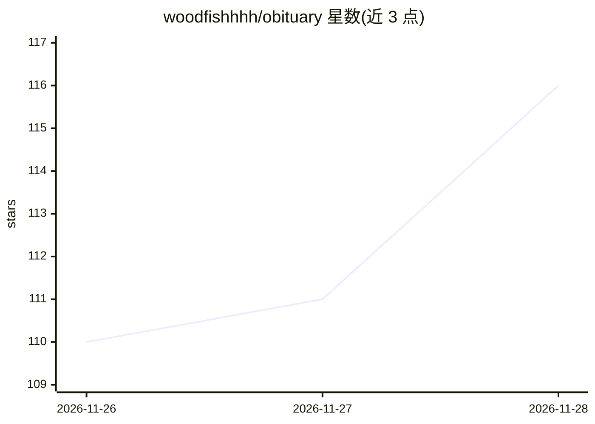

# woodfishhhh/obituary

⭐ 116 · Go · MIT · 推送 2026-11-27 · [GitHub](https://github.com/woodfishhhh/obituary) · [官网](obituary.woodfish.site) · 个人维护 · 中文 README

**给 AI agent 产物做自动过期与可恢复删除的回收站工具**

Obituary 定位为 AI agent 的回收站：agent 通过 obit mark 给自己写的调试脚本、日志、截图设置寿命，用户可通过右键菜单手动添加文件；到期文件进入 graveyard，默认保留 7 天可原位恢复，之后才真正删除。删除护栏可拦截 agent 的 rm -rf、git clean 等命令并转为可恢复的 obit 命令，obit init 可将 Obituary 注册进 agent 的指令（hooks、Agent Skill、可选 MCP）。提供 CLI、托盘常驻、Windows/Ubuntu 小窗口，支持中英双语，覆盖 Docker 容器与 Docker 卷的生命周期管理。

## 筛选速览

| 维度 | 判定 | 备注 |
|---|---|---|
| AI 角色 | `ai-ecosystem` | LLM/agent 周边工具 |
| 许可风险 | `permissive` | MIT |
| 部署形态 | `desktop` | 安装包/桌面程序 |
| 模型依赖 | — | README 未给出锁定关系 |
| 硬件要求 | — | 无带数字的原话,不猜 |
| 安装摩擦 | `low` | 无编译、无系统依赖或容器化 |
| 成熟度 | `idea` | |

## 能力要点

- 文件按寿命自动过期并进入 graveyard，7 天内可原位恢复且不覆盖现有文件
- 删除护栏拦截 agent 的 rm -rf、git clean、find -delete 等并转为可恢复操作
- obit init 一键接入 30 种 agent（hooks、Agent Skill、可选 MCP）
- 基于卷序列号与 128 位文件 ID 追踪，改名/移动后仍可识别

## 适用场景

- 清理 agent 会话留下的调试脚本、日志与截图
- 防止 agent 误删导致文件永久丢失
- 给 Downloads 等目录设置自动清理策略
- 给临时 Docker 容器和缓存卷设置到期自动停止

## 场景标签

 · 领域:开发工具/文件管理

## 证据(README 行号)

> L18: Obituary is the trash bin for AI agents: the agent and you decide what goes in. An agent gives the debug scripts, l
> L32: - **The agent decides what goes in.** `obit init` adds Obituary to the agent's instructions (`OBIT.md`, an Agent Sk
> L55:  Agents Obituary connects to: Claude Code, Codex, Cursor, GitHub Copilot, Gemini CLI, Windsurf, Trae, Qoder, CodeBu

## 星数曲线

2026-11-26 110 → 2026-11-28 116（+6）

---
*卡片 v1 · prompt 1.4 · 生成 2026-11-26 · 置信度 high · 依据 README sha `3f3584a0a88b` · [字段定义](../../DATASET.md)*
