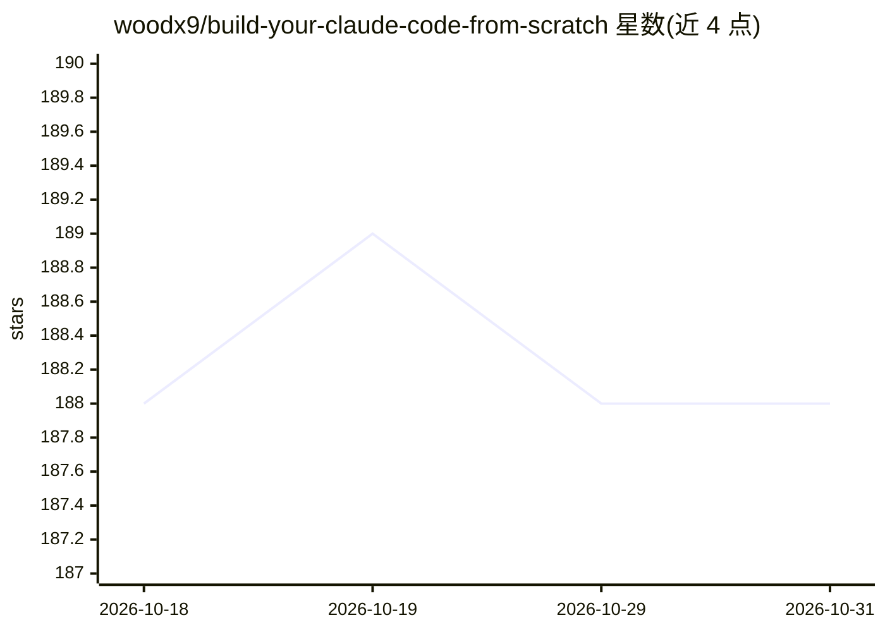

# woodx9/build-your-claude-code-from-scratch

⭐ 188 · Python · MIT · 推送 2026-05-18 · [GitHub](https://github.com/woodx9/build-your-claude-code-from-scratch) · [官网](https://deepwiki.com/woodx9/build-your-claude-code-from-scratch) · 个人维护 · 中文 README

**从零构建类 Claude Code 编程 agent 的渐进式教程项目**

教学性质的 Python 项目：以 8 个递进章节演示 AI agent 的开发，从 OpenAI 兼容的 Tool Call API、ReAct 架构、流式输出，到历史压缩、上下文裁剪、TodoWrite 任务管理、子 agent 架构与 MCP 客户端实现，最终形成可运行的命令行 agent Quick Star CLI。面向希望学习 coding agent 内部机制的开发者。API 接入要求任何 OpenAI 兼容端点（推荐 OpenRouter），需配置 .env 中的 API key 等环境变量，Python 3.8+ 运行。

## 筛选速览

| 维度 | 判定 | 备注 |
|---|---|---|
| AI 角色 | `ai-knowledge` | 知识聚合/清单类 |
| 许可风险 | `permissive` | MIT |
| 部署形态 | `library` | 以包/库形式分发 |
| 模型依赖 | locked-api |  |
| 硬件要求 | — | 无带数字的原话,不猜 |
| 安装摩擦 | `low` | 无编译、无系统依赖或容器化 |
| 成熟度 | — | 结构信号不足 |

## 能力要点

- 8 章递进内容：工具调用→ReAct→流式→历史压缩→上下文裁剪→任务管理→子 agent→MCP 客户端
- 可运行的 Quick Star CLI（流式输出、代码生成、token 与成本追踪）
- MCP 协议客户端实现：动态工具加载与多服务器连接
- 支持任意 OpenAI 兼容 API（OpenRouter/OpenAI/本地 LLM 服务器）

## 适用场景

- 逐步学习 coding agent 的构建原理与各组件实现
- 获得一个可本地运行的命令行 AI 编程助手
- 参考 MCP 客户端与子 agent 架构的实现方式

## 场景标签

`教程课程` `编码 Agent` · 领域:编码与开发

## 证据(README 行号)

> L22: This project demonstrates the progressive development of AI agents, from basic tool calling to advanced streaming a
> L33: ### Chapter 1: Tool Call API Fundamentals
> L82: ### Chapter 8: MCP Client Implementation

## 星数曲线

2026-10-18 188 → 2026-10-31 188（+0）

---
*卡片 v1 · prompt 1.4 · 生成 2026-10-22 · 置信度 high · 依据 README sha `e1bb55732baf` · [字段定义](../../DATASET.md)*
