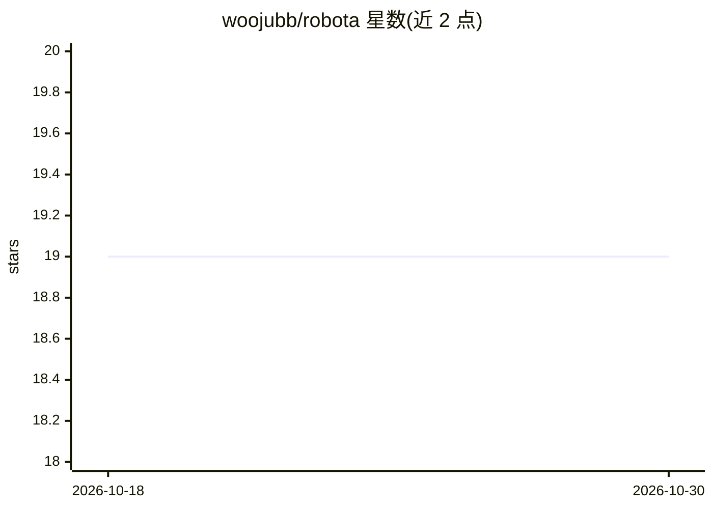

# woojubb/robota

⭐ 19 · TypeScript · AGPL-3.0 · 推送 2026-10-29 · [GitHub](https://github.com/woojubb/robota) · [官网](https://robota.io) · 组织维护

**面向开发者的 TypeScript AI agent 构建框架与 CLI 编码助手**

提供一组以 @robota-sdk/ 发布的 TypeScript 组合式库：agent-core 承载会话与工具调用，提供商包覆盖 Anthropic、OpenAI、Gemini、DeepSeek/Qwen/Gemma（经 OpenAI 兼容端点，含 vLLM 等本地服务器），并含权限模式、沙箱、插件/事件、会话守护进程、MCP 双向接入与多传输层。在此之上组装出 agent-cli 终端编码助手，支持 npx 运行或独立二进制安装。当前版本为 3.0.0-beta，API 可能变动；npm 包要求 Node.js 22.12+，macOS 终端下 CJK 输入法存在崩溃提示。

## 筛选速览

| 维度 | 判定 | 备注 |
|---|---|---|
| AI 角色 | `ai-ecosystem` | LLM/agent 周边工具 |
| 许可风险 | `dual` | AGPL-3.0 |
| 部署形态 | `library` | 以包/库形式分发 |
| 模型依赖 | local-ok | 支持本地模型 |
| 硬件要求 | — | 无带数字的原话,不猜 |
| 安装摩擦 | `low` | 无编译、无系统依赖或容器化 |
| 成熟度 | `idea` | |

## 能力要点

- 多提供商 agent 库（Anthropic/OpenAI/Gemini/DeepSeek/Qwen/Gemma 及任意 OpenAI 兼容端点）+ FallbackProvider 故障切换
- Zod 校验函数工具与内置编码工具（shell/read/write/edit/glob/grep/web）
- 权限模式、OS 级沙箱（bubblewrap/Seatbelt）、生命周期插件与 OpenTelemetry 遥测
- 会话守护进程、MCP 双向接入（客户端与服务端）、WebSocket/HTTP/WebRTC/ACP 多传输层

## 适用场景

- 在自有 TypeScript 应用中嵌入多提供商 AI agent
- 搭建带权限管控与沙箱的终端编码助手
- 构建可恢复、可 fork 的长时会话与多 agent 圆桌对话

## 场景标签

`Agent 框架` `编码 Agent` `多智能体` · 领域:Agent 开发

## 证据(README 行号)

> L7: Today, Robota provides composable TypeScript libraries with strict types, multi-provider
> L9: the same environment. `@robota-sdk/agent-cli` delivers a terminal agent with coding capabilities,
> L65: `agent-framework` provides `createQuery` with built-in tools and permission checks. Install it with

## 星数曲线

2026-10-18 19 → 2026-10-30 19（+0）

---
*卡片 v1 · prompt 1.4 · 生成 2026-10-28 · 置信度 high · 依据 README sha `a32da450bedc` · [字段定义](../../DATASET.md)*
