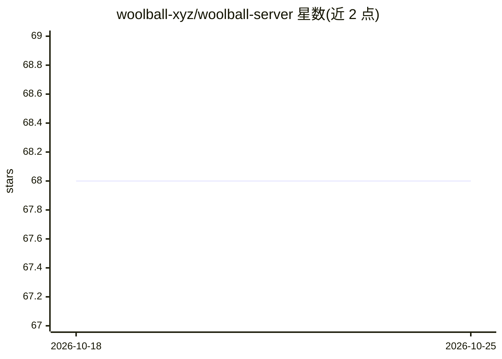

# woolball-xyz/woolball-server

⭐ 68 · C# · AGPL-3.0 · 推送 2026-02-26 · [GitHub](https://github.com/woolball-xyz/woolball-server) · [官网](https://open.woolball.xyz) · 组织维护

**把空闲浏览器组成分布式算力网络的 AI 推理服务器**

开源网络服务器，将浏览器节点组成分布式算力网络来编排 AI 推理任务，客户端在 woolball-client 仓库。支持的推理 provider 包括 Transformers.js、WebLLM（MLC 模型）、MediaPipe（LiteRT）与 Kokoro.js，覆盖文本生成、语音识别（Whisper）、文本转语音、翻译（NLLB 200+ 语言）等任务。部署方式为 git clone deploy 分支后 docker compose 启动，或一键部署到 DigitalOcean App Platform（含 Redis 托管实例），通过 REST API 与 WebSocket 与节点通信。推理在浏览器端执行，依赖客户端节点在线。

## 筛选速览

| 维度 | 判定 | 备注 |
|---|---|---|
| AI 角色 | `ai-ecosystem` | LLM/agent 周边工具 |
| 许可风险 | `viral` | AGPL-3.0 |
| 部署形态 | `self-host` | docker 或自建部署 |
| 模型依赖 | — | README 未给出锁定关系 |
| 硬件要求 | — | 无带数字的原话,不猜 |
| 安装摩擦 | `low` | 无编译、无系统依赖或容器化 |
| 成熟度 | — | 结构信号不足 |

## 能力要点

- 浏览器节点作为分布式推理算力，含作业编排与节点管理后台服务
- 4 类 provider：Transformers.js / WebLLM / MediaPipe / Kokoro.js
- 支持文本生成、语音识别（Whisper）、TTS（MMS/Kokoro 多音色）、翻译（NLLB 200+ 语言）
- Docker Compose 本地部署或一键部署到 DigitalOcean

## 适用场景

- 利用访客或机构内空闲浏览器搭建自有推理 API
- 不依赖云端 GPU 运行小规模文本/语音/翻译任务
- 以 REST API 形式为应用提供浏览器端算力的推理服务

## 场景标签

`推理引擎` · 领域:训练与推理

## 证据(README 行号)

> L19: Woolball Server is an **open-source network server** that orchestrates AI inference jobs across a distributed netwo
> L99: - **⚙️ Background Service**: Job orchestration and node management

## 星数曲线

2026-10-18 68 → 2026-10-25 68（+0）

---
*卡片 v1 · prompt 1.4 · 生成 2026-10-24 · 置信度 high · 依据 README sha `f45ad2c39fd1` · [字段定义](../../DATASET.md)*
