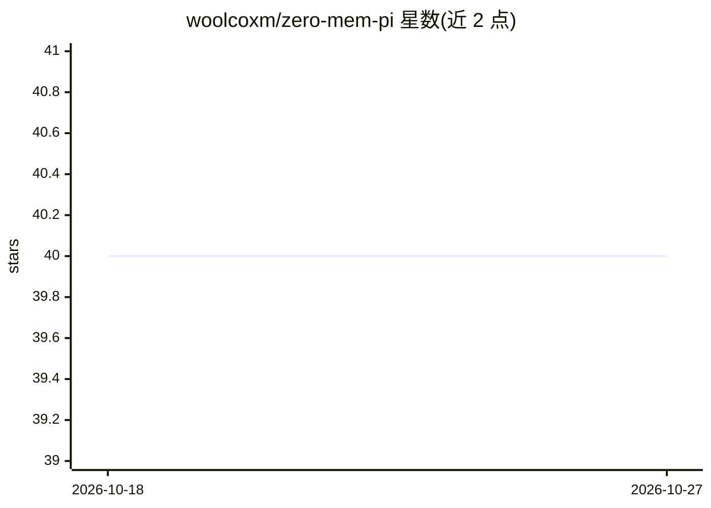

# woolcoxm/zero-mem-pi

⭐ 40 · TypeScript · MIT · 推送 2026-08-14 · [GitHub](https://github.com/woolcoxm/zero-mem-pi) · 个人维护

**pi 编码代理的零 token 长期记忆扩展，跨会话检索注入上下文**

pi coding agent 的记忆扩展，忠实复现论文 Zero-Mem（arXiv:2607.29377）：被动捕获每条会话消息为带实体与溯源的 trace unit，用 bge-small-en-v1.5 编码；每条新提示经零 LLM 流水线（BM25+dense 混合检索 + Personalized PageRank 实体图 + 证据闭包）确定性地选出最多 3 条片段注入系统提示，全程不额外调用 LLM。记忆按项目作用域持久化到本地（int8 量化嵌入 sidecar），超 1 万单元时切换自实现 HNSW 索引；支持保留策略、身份槽、跨项目回退与大量环境变量调参，并附确定性检索评测脚本。限制：时序层级仅部分实现，检索质量自述为有竞争力的而非 SOTA。

## 筛选速览

| 维度 | 判定 | 备注 |
|---|---|---|
| AI 角色 | `ai-ecosystem` | LLM/agent 周边工具 |
| 许可风险 | `permissive` | MIT |
| 部署形态 | `library` | 以包/库形式分发 |
| 模型依赖 | — | README 未给出锁定关系 |
| 硬件要求 | — | 无带数字的原话,不猜 |
| 安装摩擦 | `low` | 无编译、无系统依赖或容器化 |
| 成熟度 | `idea` | |

## 能力要点

- 零 LLM 调用的记忆捕获与确定性检索，注入开销约 103 token/回合
- BM25+dense coverage 融合 + PPR 实体图路由
- int8 量化嵌入存储与 10k 单元后自动启用纯 JS HNSW 索引
- 环境变量可调注入数量、保留上限、融合策略、嵌入模型等

## 适用场景

- 让 pi 编码代理在新会话中记得此前会话的内容与身份
- 本地小模型场景下控制记忆管理的 token 与延迟开销
- 对跨会话记忆检索做确定性、可复现的评测

## 场景标签

`Agent 记忆` · 领域:Agent 开发

## 证据(README 行号)

> L3: Zero-token long-term memory for the pi coding agent — a faithful
> L10: the model's context. Your local model (e.g. Qwen3-Coder-Next) is the only thing
> L43: - On each prompt, a **zero-LLM pipeline** routes between two views — the entity–context graph scored by **Personali

## 星数曲线

2026-10-18 40 → 2026-10-27 40（+0）

---
*卡片 v1 · prompt 1.4 · 生成 2026-10-25 · 置信度 high · 依据 README sha `0abcb4ab2f73` · [字段定义](../../DATASET.md)*
