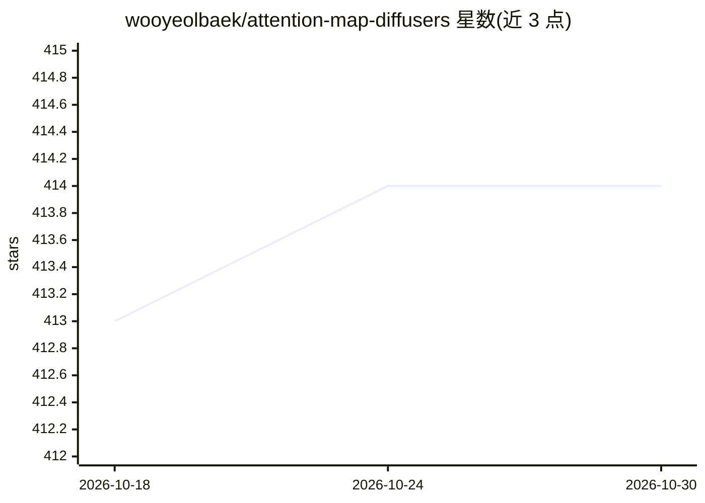

# wooyeolbaek/attention-map-diffusers

⭐ 414 · Python · MIT · 推送 2026-08-07 · [GitHub](https://github.com/wooyeolbaek/attention-map-diffusers) · [官网](https://huggingface.co/spaces/We-Want-GPU/diffusers-cross-attention-map-SDXL-t2i) · 个人维护

**面向 Diffusers 图像/视频管线的注意力捕获与可视化工具**

为 Hugging Face Diffusers 的图像与视频生成管线提供关系感知的注意力捕获与可视化：支持 token↔token、text↔image、text↔video、video↔video 等关系的注意力图输出，覆盖 FLUX、SD/SDXL/SD3、Sana、CogVideoX、Wan、HunyuanVideo 等 13 个模型检查点。提供 Python API 与共享 runner 脚本，输出含 metadata 的可视化结果，默认保留最后时间步与 head 均值，含 8 GiB 累计捕获防护、逐层/全时间步选项及生成一致性校验脚本。需 Python 3.10+ 与 diffusers>=0.39.0，以 pip 包形式安装。

## 筛选速览

| 维度 | 判定 | 备注 |
|---|---|---|
| AI 角色 | `ai-ecosystem` | LLM/agent 周边工具 |
| 许可风险 | `permissive` | MIT |
| 部署形态 | `library` | 以包/库形式分发 |
| 模型依赖 | — | README 未给出锁定关系 |
| 硬件要求 | — | 无带数字的原话,不猜 |
| 安装摩擦 | `low` | 无编译、无系统依赖或容器化 |
| 成熟度 | — | 结构信号不足 |

## 能力要点

- 支持 13 个检查点、覆盖 image/text 与 video/text 全部注意力关系
- 默认 8 GiB 累计捕获防护，防止内存/显存静默耗尽
- 含审计覆盖与生成一致性校验脚本（pytest/dry-run/parity）
- 提供 metadata.json 记录出处与捕获设置

## 适用场景

- 可视化 text-to-image/video 模型中 prompt token 与生成内容的注意力关系
- 对比不同扩散模型检查点的交叉注意力与自注意力行为
- 研究中核对注意力捕获完整性与生成结果一致性

## 场景标签

`科研工具` · 领域:学习与行业

## 证据(README 行号)

> L3: Relation-aware attention capture and visualization for Hugging Face Diffusers
> L49: |Key|Checkpoint|Relations|

## 星数曲线

2026-10-18 413 → 2026-10-30 414（+1）

---
*卡片 v1 · prompt 1.4 · 生成 2026-10-21 · 置信度 high · 依据 README sha `6e4136518b33` · [字段定义](../../DATASET.md)*
