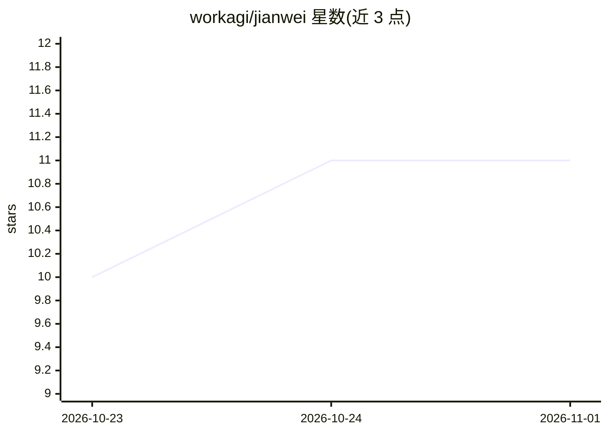

# workagi/jianwei

⭐ 11 · TypeScript · Apache-2.0 · 推送 2026-10-19 · [GitHub](https://github.com/workagi/jianwei) · 组织维护 · 中文 README

**自托管信息聚合监控：统一跟踪 X、公众号、搜索与 RSS 更新**

自部署的信息监控与阅读平台：添加 X 账号、微信公众号、关键词搜索、榜单或 RSS 作为监控任务，系统定时采集、规则过滤去重，可接入 OpenAI 兼容模型 API 生成中文摘要、标题、分类与推荐理由，并把多篇报道归并为同一事件、以事件变化为阅读入口。面向个人或共用工作台的团队，无多用户独立账户。通过 Docker Compose 部署，主程序 Apache-2.0，第三方采集服务（WeRSS、TrendRadar）适用各自许可证；公众号采集组件 WeRSS 仅提供 linux/amd64 镜像。

## 筛选速览

| 维度 | 判定 | 备注 |
|---|---|---|
| AI 角色 | `ai-enhanced` | 去掉 AI 部分产品仍成立 |
| 许可风险 | `permissive` | Apache-2.0 |
| 部署形态 | `self-host` | docker 或自建部署 |
| 模型依赖 | — | README 未给出锁定关系 |
| 硬件要求 | — | 无带数字的原话,不猜 |
| 安装摩擦 | `low` | 无编译、无系统依赖或容器化 |
| 成熟度 | — | 结构信号不足 |

## 能力要点

- 多源采集统一为一条信息流：X、微信公众号、全网搜索、榜单/RSS
- 规则先于模型：无关内容先经规则过滤，模型按需小批量处理（L262、L59）
- 事件归并与变化阅读：重复报道不重复提醒，新阶段变化再出现
- 支持 OpenAI Chat Completions 兼容接口，可接入 DeepSeek、火山方舟等

## 适用场景

- 长期关注指定 X 博主和微信公众号的更新，减少多平台切换
- 品牌与关键词的全网舆情监控与筛选
- 把英文资讯统一整理成中文摘要后阅读
- 按事件跟踪进展，只看新变化不看重复报道

## 场景标签

`网页抓取` `AI 写作` · 领域:效率与自动化

## 证据(README 行号)

> L8: 把你想长期关注的 X 博主、微信公众号、行业关键词、榜单和 RSS 交给见微。它会持续替你跟踪更新，过滤重复和无关内容，把外文资讯整理成中文，并告诉你每条内容为什么值得看。
> L58: |一定要配置模型吗？|不需要。采集可以独立运行；启用模型后才会生成更好的摘要、中文标题、分类和推荐理由。|
> L290: 不配置模型时，见微仍然可以完成采集、去重、关键词 Gate 和信息流汇总；本地内容类型与主题规则是可解释、低成本的兜底，不等于高精度语义模型。`pnpm content:evaluate` 会同时显示当前实测结果、CI 防回归底

## 星数曲线

2026-10-23 10 → 2026-11-01 11（+1）

---
*卡片 v1 · prompt 1.4 · 生成 2026-11-01 · 置信度 mid · 依据 README sha `2e36e697cd42` · [字段定义](../../DATASET.md)*
