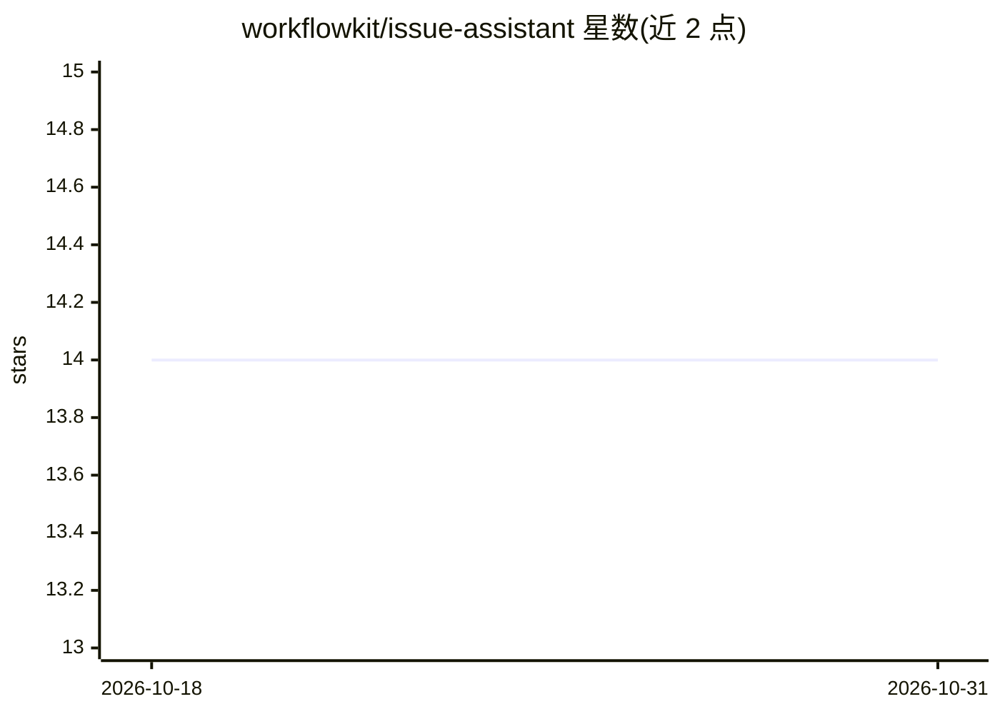

# workflowkit/issue-assistant

⭐ 14 · Go · MIT · 推送 2026-07-16 · [GitHub](https://github.com/workflowkit/issue-assistant) · 组织维护

**为 GitHub issue 自动生成 AI 回复的 GitHub Action**

以 GitHub Action 形式提供：仓库新增 issue 时读取 issue 内容与仓库代码，调用 OpenAI GPT-4 或 Anthropic Claude 生成 Markdown 格式评论，并可给出标签建议；带重试机制与置信度评分，响应模板可配置。通过在 .github/workflows 添加 YAML 并设置 OPENAI_API_KEY 或 CLAUDE_API_KEY 密钥接入，两种模型按 ai_type 二选一。面向使用 GitHub 托管项目维护流程的开发者与团队。

## 筛选速览

| 维度 | 判定 | 备注 |
|---|---|---|
| AI 角色 | `ai-native` | 本体是模型或模型工具 |
| 许可风险 | `permissive` | MIT |
| 部署形态 | `None` |  |
| 模型依赖 | locked-api |  |
| 硬件要求 | — | 无带数字的原话,不猜 |
| 安装摩擦 | `low` | 无编译、无系统依赖或容器化 |
| 成熟度 | — | 结构信号不足 |

## 能力要点

- 自动分析 issue 内容与仓库代码并发布评论
- 支持 OpenAI 与 Claude 两种模型（ai_type 二选一）
- 可生成 AI 标签建议，响应模板可自定义
- 内置重试机制与置信度评分

## 适用场景

- 自动回复仓库新增的 issue
- 让 AI 根据仓库代码上下文解答 issue 提问
- 为 issue 自动建议分类标签

## 场景标签

 · 领域:开发者工具/CI 自动化

## 证据(README 行号)

> L6: AI-powered GitHub Issue assistant that provides intelligent responses based on repository content using various AI m
> L37: - AI will post a helpful response as a comment

## 星数曲线

2026-10-18 14 → 2026-10-31 14（+0）

---
*卡片 v1 · prompt 1.4 · 生成 2026-10-31 · 置信度 high · 依据 README sha `a808f0869746` · [字段定义](../../DATASET.md)*
