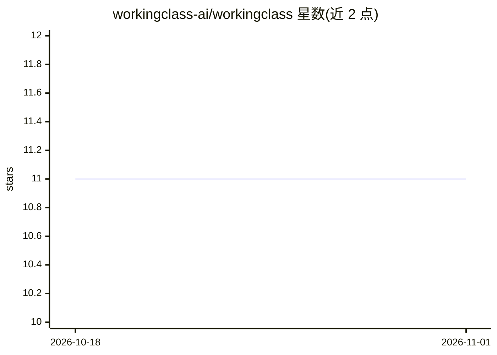

# workingclass-ai/workingclass

⭐ 11 · Python · NOASSERTION · 推送 2026-10-19 · [GitHub](https://github.com/workingclass-ai/workingclass) · 组织维护 · 中文 README

**面向劳动者的职场话术与劳动法 AI agent 技能集**

收录服务于劳动者的 agent skill，核心为『劳动者AI助手』：9 个模块加 4 个入口工具，覆盖职场话术解码、绩效 review 解读、PIP 应对、薪资谈判、被裁应对与跳槽决策，并提供 8 个法域条目（覆盖 9 个具名法域/地区）的劳动法参考。以 SKILL.md 技能形式安装到 Claude Code、Codex、Cursor 等 agent 中运行，通过 slash 命令或自然语言触发；支持 7 种语言。声明不构成法律建议，并附隐私与 OPSEC 指引。

## 筛选速览

| 维度 | 判定 | 备注 |
|---|---|---|
| AI 角色 | `ai-knowledge` | 知识聚合/清单类 |
| 许可风险 | `none` | NOASSERTION |
| 部署形态 | `None` |  |
| 模型依赖 | — | README 未给出锁定关系 |
| 硬件要求 | — | 无带数字的原话,不猜 |
| 安装摩擦 | `low` | 无编译、无系统依赖或容器化 |
| 成熟度 | — | 结构信号不足 |

## 能力要点

- 9 个核心模块 + 4 个入口工具（分诊/红旗扫描/被裁72小时/隐私OPSEC）
- 8 个法域条目覆盖 9 个具名法域/地区的劳动法参考（非法律建议）
- 兼容 Claude Code / Codex / Cursor，含 Cursor Project Rule 与通用 AGENTS.md
- 支持简体中文、繁体中文、英语、西/法/葡/德 7 种语言

## 适用场景

- 把老板或 HR 的话术贴给 agent，解码其真实意图
- 被裁员或进入 PIP 时获取应对步骤与谈判 playbook
- 查询所在法域的劳动法条目作为参考框架
- 做加班、跳槽留任、薪资谈判等决策分析

## 场景标签

`AI 助手` · 领域:对话与助手

## 证据(README 行号)

> L8: 这个仓库收录服务于劳动者的 agent skills 和工具。第一个，也是核心的，是 **劳动者AI助手 / Laborer's Companion**——一个帮你看穿职场话术、做出对自己最好的决定的工具。
> L37: ### 1. `skills/laborer-companion/` — 劳动者AI助手
> L39: 9 个核心模块 + 4 个入口工具，覆盖职场全景：

## 星数曲线

2026-10-18 11 → 2026-11-01 11（+0）

---
*卡片 v1 · prompt 1.4 · 生成 2026-11-01 · 置信度 high · 依据 README sha `aeae704c5fe9` · [字段定义](../../DATASET.md)*
