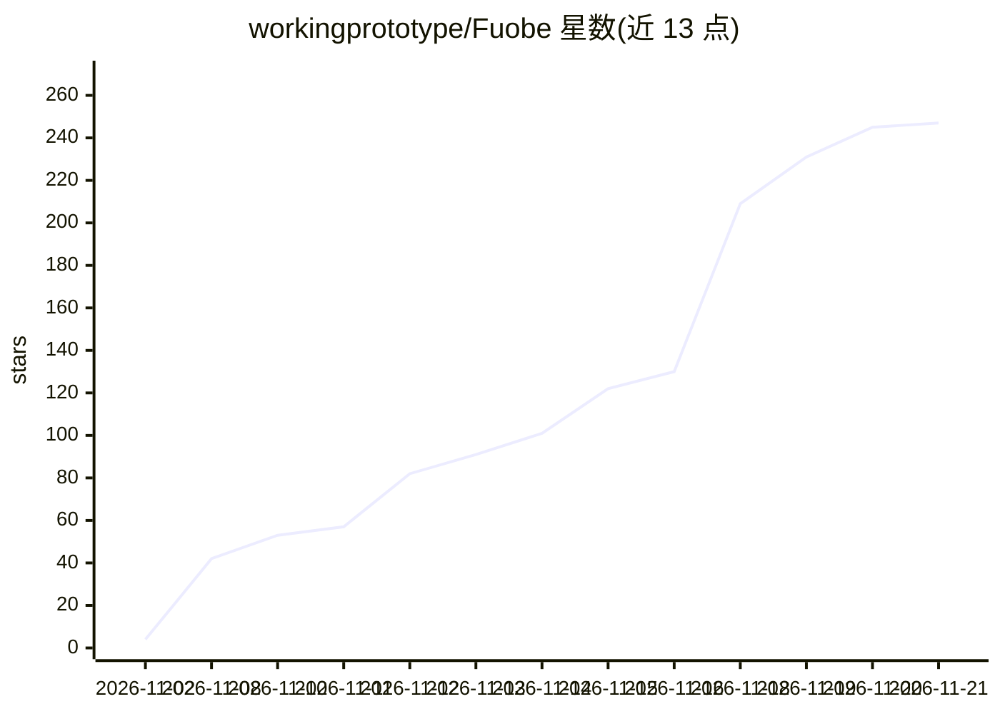

# workingprototype/Fuobe

⭐ 247 · TypeScript · MIT · 推送 2026-11-19 · [GitHub](https://github.com/workingprototype/Fuobe) · [官网](https://fuobe.com) · 组织维护

**自托管的开放权重创意工作室：图/视频/3D/音频一站生成**

基于 ComfyUI 与 Next.js 16 的自托管创意工作室，覆盖图像、视频、3D 与音频生成：29 个 studio、108 种镜头运动、255 种特效、132 个一键应用与 62 个 FX 工具，另有图层编辑、Live edit（边打字边改图）、Image to 3D 和在聊天中规划并执行任务的 Assist agent。引擎模式一个开关切换：本地 GPU 上的 ComfyUI 开放权重（268 个 API 工作流），或自带 key 的 fal.ai / Replicate 云端模型；提示词辅助可接 Ollama、LM Studio 或任意 OpenAI 兼容服务。源码 git clone + pnpm 运行，数据与密钥默认保存在本机 data/ 目录。

## 筛选速览

| 维度 | 判定 | 备注 |
|---|---|---|
| AI 角色 | `ai-native` | 本体是模型或模型工具 |
| 许可风险 | `permissive` | MIT |
| 部署形态 | `library` | 以包/库形式分发 |
| 模型依赖 | local-ok | 支持本地模型 |
| 硬件要求 | — | 无带数字的原话,不猜 |
| 安装摩擦 | `medium` | 含编译或系统依赖之一 |
| 成熟度 | — | 结构信号不足 |

## 能力要点

- 29 个 studio、108 种镜头运动、255 种特效、132 个应用、62 个 FX 工具
- 一个开关切换本地 ComfyUI 开放权重或 fal.ai / Replicate 云端模型
- 268 个 ComfyUI API 格式工作流，其中 191 个已对照真实节点定义验证
- Assist agent 在聊天中展示任务计划与成本，批准后执行

## 适用场景

- 在自己 GPU 上用开放权重生成图像、视频、3D 与音频
- 为电商、广告、时尚内容使用一键应用与营销模板
- FX 团队做换脸、抠像、延长镜头、变速与调色等后期处理
- 不接任何后端时开启占位结果模式做产品导览

## 场景标签

`图像生成` `视频生成` `图像视频处理` · 领域:内容生成

## 证据(README 行号)

> L17:  Fuobe is a complete creative studio that you run yourself.
> L18:  Use open-weight models through ComfyUI on your own GPU, or frontier models with your own fal.ai or Replicate key.
> L104:  Settings: Open source only and local models

## 星数曲线

2026-11-02 4 → 2026-11-21 247（+243）

---
*卡片 v1 · prompt 1.4 · 生成 2026-11-17 · 置信度 high · 依据 README sha `1b26f37855d8` · [字段定义](../../DATASET.md)*
