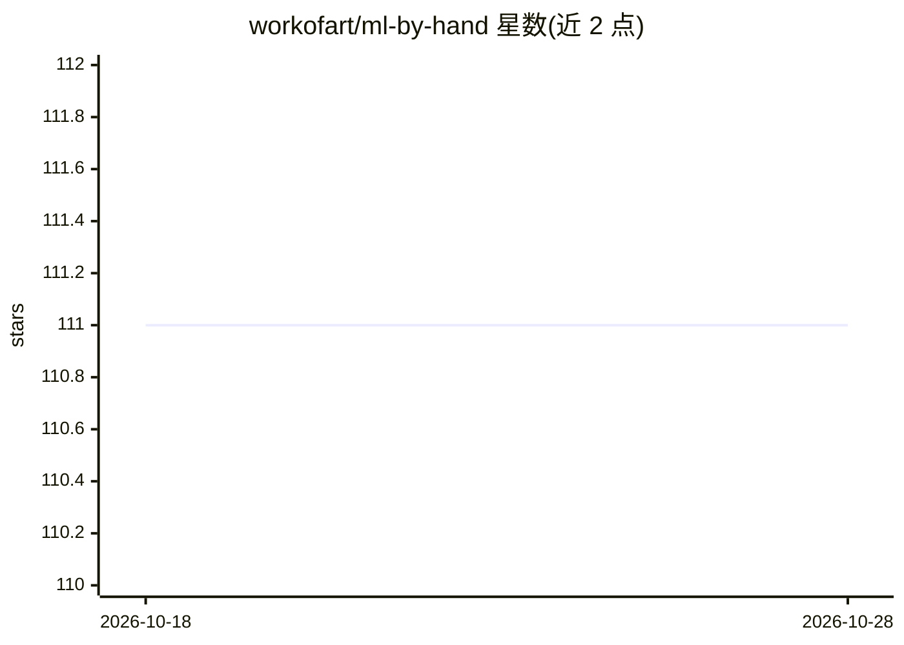

# workofart/ml-by-hand

⭐ 111 · Python · MIT · 推送 2026-06-17 · [GitHub](https://github.com/workofart/ml-by-hand) · [官网](https://ml-by-hand.readthedocs.io/en/latest/) · 个人维护

**从零手写的深度学习库与教学示例，附 GPT-2 训练实践**

从自动微分引擎演化而来的从零实现深度学习库：所有数学与梯度计算在代码中显式推导，API 接口贴近 PyTorch 以降低上手成本。数值后端通过 autograd.backend.xp 别名自动绑定 numpy/mlx/cupy，可在单 CPU 上训练 GPT 模型。示例覆盖 Transformer、GPT-1/2、SFT、GRPO、CNN/ResNet、RNN/LSTM 等任务，并提供在 OpenWebText 上从零预训练的 GPT-2 124M 检查点（约 240MB）供本地推理，附带 BPE 分词器词表。定位为第一性原理学习工具，不以速度和内存优化为目标。

## 筛选速览

| 维度 | 判定 | 备注 |
|---|---|---|
| AI 角色 | `ai-native` | 本体是模型或模型工具 |
| 许可风险 | `permissive` | MIT |
| 部署形态 | `None` |  |
| 模型依赖 | — | README 未给出锁定关系 |
| 硬件要求 | — | 无带数字的原话,不猜 |
| 安装摩擦 | `medium` | 含编译或系统依赖之一 |
| 成熟度 | — | 结构信号不足 |

## 能力要点

- 从零实现的 autograd 引擎，梯度计算无黑盒
- numpy/mlx/cupy 多硬件后端自动选择，可用单 CPU 训练 GPT
- 示例含 GPT-2 预训练、SFT 微调、GRPO 强化学习
- 提供预训练 GPT-2 124M 检查点本地推理

## 适用场景

- 通过阅读和运行代码学习深度学习的底层原理
- 在自己的数据上微调或复用 GPT-2 检查点做推理
- 参考 GRPO/SFT 示例学习 LLM 训练技术

## 场景标签

`教程课程` `微调` `模型训练` `强化学习` · 领域:学习与行业

## 证据(README 行号)

> L8: We are creating a deep learning library from scratch (that evolved from a simple autograd engine). It is designed to
> L21:  This project initially took inspiration from Micrograd, which was trying to build an **Autograd** (Wikipedia) engi

## 星数曲线

2026-10-18 111 → 2026-10-28 111（+0）

---
*卡片 v1 · prompt 1.4 · 生成 2026-10-23 · 置信度 high · 依据 README sha `e0851e685e50` · [字段定义](../../DATASET.md)*
