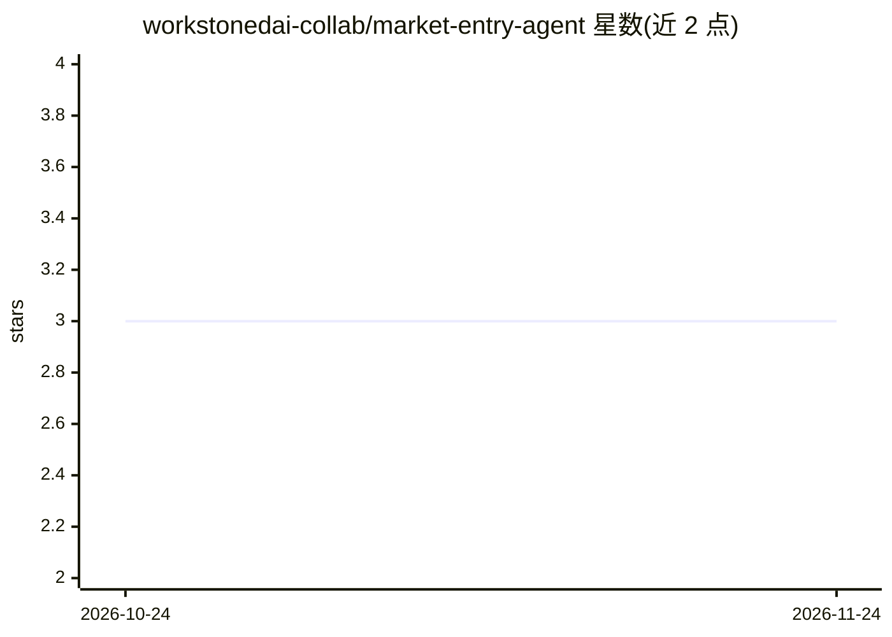

# workstonedai-collab/market-entry-agent

⭐ 3 · Python · MIT · 推送 2026-10-29 · [GitHub](https://github.com/workstonedai-collab/market-entry-agent) · 组织维护 · 中文 README

**面向出海企业的市场进入研究与营商环境监测智能体**

一个 Python 编写、可自部署的研究智能体：用户描述产品、客户、目标市场与约束后，它检索公开来源并结合私有知识库材料，产出带引用来源的市场进入路径分析、交易责任与贡献额测算，以及经营前提变化的持续跟踪。提供网页工作区、离线演示、Word/Markdown/JSON 导出、本地 OfficeCLI 与 MCP 接口。当前为 Alpha 阶段，离线演示不需要模型密钥；真实研究需自行配置模型与来源，部分研究方法与提示词未开源。

## 筛选速览

| 维度 | 判定 | 备注 |
|---|---|---|
| AI 角色 | `ai-native` | 本体是模型或模型工具 |
| 许可风险 | `permissive` | MIT |
| 部署形态 | `desktop` | 安装包/桌面程序 |
| 模型依赖 | — | README 未给出锁定关系 |
| 硬件要求 | — | 无带数字的原话,不猜 |
| 安装摩擦 | `low` | 无编译、无系统依赖或容器化 |
| 成熟度 | `idea` | |

## 能力要点

- 选市场与进入方式、交易责任与测算、经营前提跟踪三类研究任务
- 私有知识库按项目组织，引用保留文档版本与出处位置
- 持续监测工作进程支持规则模式与模型模式，可接飞书等渠道（Hermes）
- 离线演示无需模型密钥与外部服务；支持经验整理与技能启用/回退

## 适用场景

- 比较两个目标市场的准入、渠道与交付条件
- 区分进口安排中各方责任并按同一口径测算贡献额
- 进入市场后持续跟踪政策与规则变化对已有方案的影响
- 把仓库交给自己的 Agent 按说明完成部署

## 场景标签

 · 领域:企业出海咨询/商业智能

## 证据(README 行号)

> L14: 这是一个围绕企业实际情况做出海研究、并持续跟踪目标市场变化的智能体。告诉它你卖什么、服务什么客户、打算去哪里、目前处在哪个阶段，以及预算、渠道和交付有哪些约束，它会检索公开信息，阅读相关材料，梳理进入路径、经营条件、值得验证的机会
> L60: A research agent for the choices businesses face when entering and operating in overseas markets. Describe the prod
> L116: Choose **market and entry options** to compare markets and routes under your business conditions. Choose **transac

## 星数曲线

2026-10-24 3 → 2026-11-24 3（+0）

---
*卡片 v1 · prompt 1.4 · 生成 2026-11-21 · 置信度 mid · 依据 README sha `830ea8fa2d3c` · [字段定义](../../DATASET.md)*
