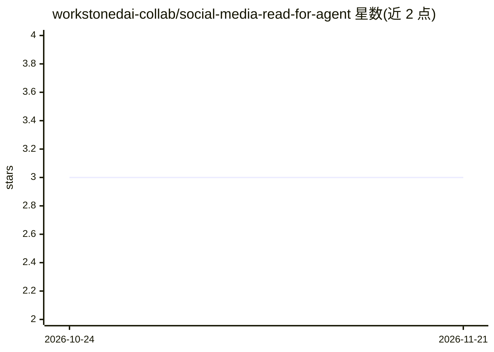

# workstonedai-collab/social-media-read-for-agent

⭐ 3 · Python · MIT · 推送 2026-10-24 · [GitHub](https://github.com/workstonedai-collab/social-media-read-for-agent) · 组织维护 · 中文 README

**给本地 Agent 提供国内社媒搜索与只读阅读的 MCP 工具**

为已有本地 Agent 提供七个只读 MCP 工具（搜索、读正文、读有限评论、任务查询等），覆盖小红书、微博、知乎和微信公众号，并可通过 CLI 或本地网页使用。读取来源为真实账号登录后的浏览器连接，结果附来源链接、取得时间与失败原因；小红书支持逐图本机 OCR（RapidOCR/Mac Vision），平台限流后统一冷却一小时。预览版，主要支持 macOS+Chrome，Linux 覆盖核心工具与依赖安装，Windows 自动浏览器设置未验收。

## 筛选速览

| 维度 | 判定 | 备注 |
|---|---|---|
| AI 角色 | `ai-ecosystem` | LLM/agent 周边工具 |
| 许可风险 | `permissive` | MIT |
| 部署形态 | `None` |  |
| 模型依赖 | — | README 未给出锁定关系 |
| 硬件要求 | — | 无带数字的原话,不猜 |
| 安装摩擦 | `low` | 无编译、无系统依赖或容器化 |
| 成熟度 | `idea` | |

## 能力要点

- 七个统一只读 MCP 工具，兼容任何支持本地 MCP stdio 的客户端
- 小红书轮播图逐图本机 OCR，图片不发送到在线 OCR 服务
- 限流冷却策略跨 CLI/MCP 实例生效，已缓存内容冷却期仍可读取
- 安装器下载固定版本独立 Python/Node 并校验 SHA256，不改系统环境

## 适用场景

- 产品开发前跨平台搜索用户需求与反例
- 核对用户真实反馈并区分品牌推广与教程
- 给 Agent 一条内容链接，读取正文及图中文字

## 场景标签

`OCR` · 领域:感知与多模态

## 证据(README 行号)

> L11: 项目标识：`social-media-read-for-agent`。为已有 Agent 提供七个只读 MCP 工具，也可以通过命令行或本地网页使用。本项目无需额外的模型 API 密钥；你的 Agent 自身仍按原来的方式运行。
> L129: MCP 客户端配置由安装器生成，入口是绝对路径 `start_mcp.py`，不依赖 Agent 当前工作目录。兼容任何支持本地 **MCP stdio** 的客户端：

## 星数曲线

2026-10-24 3 → 2026-11-21 3（+0）

---
*卡片 v1 · prompt 1.4 · 生成 2026-11-21 · 置信度 high · 依据 README sha `f51d156de2f5` · [字段定义](../../DATASET.md)*
