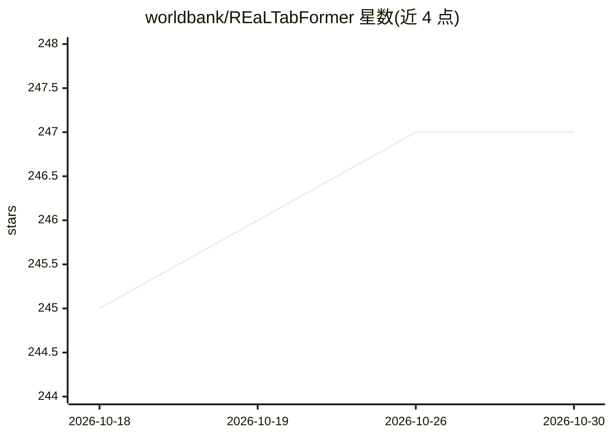

# worldbank/REaLTabFormer

⭐ 247 · Jupyter Notebook · MIT · 推送 2026-01-04 · [GitHub](https://github.com/worldbank/REaLTabFormer) · [官网](https://worldbank.github.io/REaLTabFormer/) · 组织维护

**用 Transformer 生成表格与关系型合成数据的模型套件**

提供统一框架合成不同类型的表格数据：非关系型表格数据基于 GPT-2 的自回归模型，关系型数据使用 Seq2Seq 模型。训练非关系型模型时实现基于合成数据分布的最优停止准则。提供观测验证器接口（如 GeoValidator）过滤无效合成样本。以 Python 包形式通过 pip 安装（Python >= 3.7），附带常规表格与关系型数据的建模与生成示例，并有 arXiv 论文。

## 筛选速览

| 维度 | 判定 | 备注 |
|---|---|---|
| AI 角色 | `ai-native` | 本体是模型或模型工具 |
| 许可风险 | `permissive` | MIT |
| 部署形态 | `library` | 以包/库形式分发 |
| 模型依赖 | — | README 未给出锁定关系 |
| 硬件要求 | — | 无带数字的原话,不猜 |
| 安装摩擦 | `low` | 无编译、无系统依赖或容器化 |
| 成熟度 | — | 结构信号不足 |

## 能力要点

- 非关系型表格基于 GPT-2，关系型数据用 Seq2Seq 模型
- 基于合成数据分布的最优停止训练准则
- 可构建观测验证器（如 GeoValidator）过滤无效合成样本

## 适用场景

- 为表格数据集生成合成数据用于隐私保护或数据增强
- 为含关系（父子表）的数据集生成合成数据
- 用地理等验证器过滤不合规的合成样本

## 场景标签

 · 领域:表格数据合成/深度学习

## 证据(README 行号)

> L5: The REaLTabFormer (Realistic Relational and Tabular Data using Transformers) offers a unified framework for synthesi
> L64: @article{solatorio2023realtabformer,

## 星数曲线

2026-10-18 245 → 2026-10-30 247（+2）

---
*卡片 v1 · prompt 1.4 · 生成 2026-10-22 · 置信度 high · 依据 README sha `7cb610ff3e1f` · [字段定义](../../DATASET.md)*
