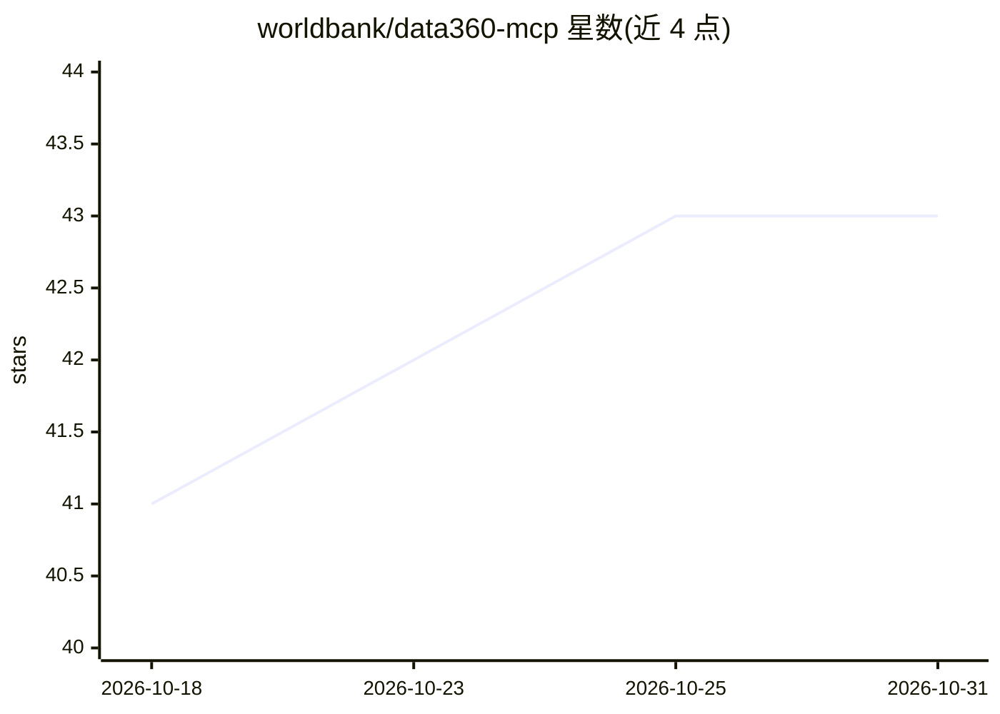

# worldbank/data360-mcp

⭐ 43 · Python · NOASSERTION · 推送 2026-09-22 · [GitHub](https://github.com/worldbank/data360-mcp) · [官网](https://worldbank.github.io/data360-mcp/) · 组织维护

**世界银行 Data360 数据的 MCP 服务器，供 LLM agent 检索发展指标**

由世界银行维护的 Model Context Protocol（MCP）服务器，让 LLM agent 与聊天机器人直接访问 Data360 平台的发展指标数据。提供 6 个 MCP 工具：指标搜索（含国家覆盖检查）、时间序列数据获取、元数据读取、分维度查询、名称到代码解析与指标列表；另含系统提示、代码表等 MCP 资源与思维链引导。支持 HTTP/SSE 传输，需 Python 3.11+，经 pip/uv 安装，附 LangChain/LangGraph 客户端示例与演示脚本。

## 筛选速览

| 维度 | 判定 | 备注 |
|---|---|---|
| AI 角色 | `ai-ecosystem` | LLM/agent 周边工具 |
| 许可风险 | `none` | NOASSERTION |
| 部署形态 | `desktop` | 安装包/桌面程序 |
| 模型依赖 | — | README 未给出锁定关系 |
| 硬件要求 | — | 无带数字的原话,不猜 |
| 安装摩擦 | `low` | 无编译、无系统依赖或容器化 |
| 成熟度 | — | 结构信号不足 |

## 能力要点

- 6 个 MCP 工具：指标搜索、数据获取、元数据、分维度查询、代码解析、指标列表
- 服务端国家覆盖检查（covers_country）与过滤器（国家/时间/性别/年龄/城乡）
- MCP 资源含系统提示与思维链引导，面向聊天机器人集成
- 提供 LangChain 最小示例与 LangGraph 多 agent 节点注册

## 适用场景

- 为 AI 聊天机器人接入世界银行权威发展数据，避免编造数值
- 构建查询 GDP、贫困、性别、气候指标的对话式数据助手
- 在 LangGraph 多 agent 系统中注册 Data360 数据节点

## 场景标签

`数据分析` · 领域:效率与自动化

## 证据(README 行号)

> L3: A Model Context Protocol (MCP) server that gives LLM agents direct access to the World Bank's Data360 Platform. Agen
> L5: > **Audience**: Developers building AI agents and chatbots that need reliable, structured access to World Bank devel

## 星数曲线

2026-10-18 41 → 2026-10-31 43（+2）

---
*卡片 v1 · prompt 1.4 · 生成 2026-10-25 · 置信度 mid · 依据 README sha `0b872d2acd5b` · [字段定义](../../DATASET.md)*
