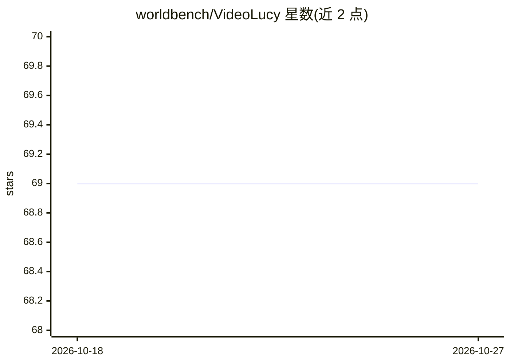

# worldbench/VideoLucy

⭐ 69 · Python · Apache-2.0 · 推送 2026-02-10 · [GitHub](https://github.com/worldbench/VideoLucy) · [官网](https://videolucy.github.io) · 组织维护 · 中文 README

**长视频理解的深记忆回溯框架，附 EgoMem 评测基准**

NeurIPS 2025 论文的官方实现：VideoLucy 采用渐进粒度的分层记忆结构与 agent 迭代回溯机制，从长视频中挖掘与问题相关的深层记忆以生成回答。默认组合为本地部署的 Qwen2.5-VL-7B（MLLM）与 API 调用的 DeepSeek-R1（LLM，默认走火山引擎 API，可改为其他 API）。同时发布 EgoMem 基准，基于 EgoLife 视频资源构建问答对，评测模型对超长视频中时序事件与细粒度细节的理解。demo 支持从 Bilibili 下载视频并做开放式问答。

## 筛选速览

| 维度 | 判定 | 备注 |
|---|---|---|
| AI 角色 | `ai-native` | 本体是模型或模型工具 |
| 许可风险 | `permissive` | Apache-2.0 |
| 部署形态 | `library` | 以包/库形式分发 |
| 模型依赖 | locked-api |  |
| 硬件要求 | — | 无带数字的原话,不猜 |
| 安装摩擦 | `low` | 无编译、无系统依赖或容器化 |
| 成熟度 | — | 结构信号不足 |

## 能力要点

- 分层记忆结构 + agent 迭代回溯的长视频理解框架
- EgoMem：基于 EgoLife 超长第一视角视频的问答评测基准
- demo 支持 Bilibili 视频下载与开放式问答
- 可切换 LLM 与推理模式、调节帧率帧数

## 适用场景

- 对超长视频做基于问答的内容理解与检索式回答
- 用 EgoMem 基准评测多模态模型的长视频理解能力
- 复现或改进 NeurIPS 2025 论文方法

## 场景标签

`多模态` `模型评测` · 领域:评测与运维

## 证据(README 行号)

> L3: We propose **VideoLucy**, a deep memory backtracking framework for long video understanding. Inspired by the human r
> L13: By default, our VideoLucy employs `Qwen2.5-VL-7B` as the MLLM and `DeepSeek-R1` as the LLM. The former is deployed 

## 星数曲线

2026-10-18 69 → 2026-10-27 69（+0）

---
*卡片 v1 · prompt 1.4 · 生成 2026-10-24 · 置信度 mid · 依据 README sha `7d26c497f23e` · [字段定义](../../DATASET.md)*
