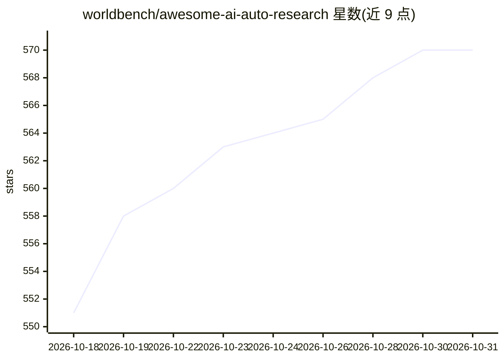

# worldbench/awesome-ai-auto-research

⭐ 570 · HTML · MIT · 推送 2026-10-30 · [GitHub](https://github.com/worldbench/awesome-ai-auto-research) · [官网](https://worldbench.github.io/awesome-ai-auto-research) · 组织维护

**AI 自动科研综述配套论文清单：覆盖科研全生命周期**

配合综述论文 "AI for Auto-Research: Roadmap & User Guide" 的论文追踪清单，收录 AI 辅助与自动化科研相关论文。将学术研究生命周期组织为四个阶段八个环节：创意生成、文献综述、编程实验、图表制作、写作、同行评审、答辩修订、成果传播；每类下按时间序列出模型条目，含论文、发表会议、网站与 GitHub 链接。可见部分覆盖创意生成（内部知识/外部信号/多智能体/新颖性评估）与文献检索、综述生成等类别。供科研人员与开发者查阅。

## 筛选速览

| 维度 | 判定 | 备注 |
|---|---|---|
| AI 角色 | `ai-knowledge` | 知识聚合/清单类 |
| 许可风险 | `permissive` | MIT |
| 部署形态 | `None` |  |
| 模型依赖 | — | README 未给出锁定关系 |
| 硬件要求 | — | 无带数字的原话,不猜 |
| 安装摩擦 | `low` | 无编译、无系统依赖或容器化 |
| 成熟度 | — | 结构信号不足 |

## 能力要点

- 按四阶段八环节组织研究生命周期的论文分类体系
- 每个条目包含模型名、论文、Venue、网站与代码链接
- 创意生成细分为 LLM 内部知识、外部信号、多智能体协作、新颖性评估等子类

## 适用场景

- 查找特定科研环节（如创意生成、文献综述）的相关论文
- 跟踪 AI 自动科研领域的最新进展与基准工作
- 作为综述论文的配套资源引用

## 场景标签

`精选清单` · 领域:学习与行业

## 证据(README 行号)

> L12: This repository accompanies the survey paper **"AI for Auto-Research: Roadmap & User Guide"** and tracks papers on 
> L16: We organize the academic research lifecycle as eight interconnected stages grouped into four epistemological phases

## 星数曲线

2026-10-18 551 → 2026-10-31 570（+19）

---
*卡片 v1 · prompt 1.4 · 生成 2026-10-21 · 置信度 high · 依据 README sha `29c6398b92a4` · [字段定义](../../DATASET.md)*
