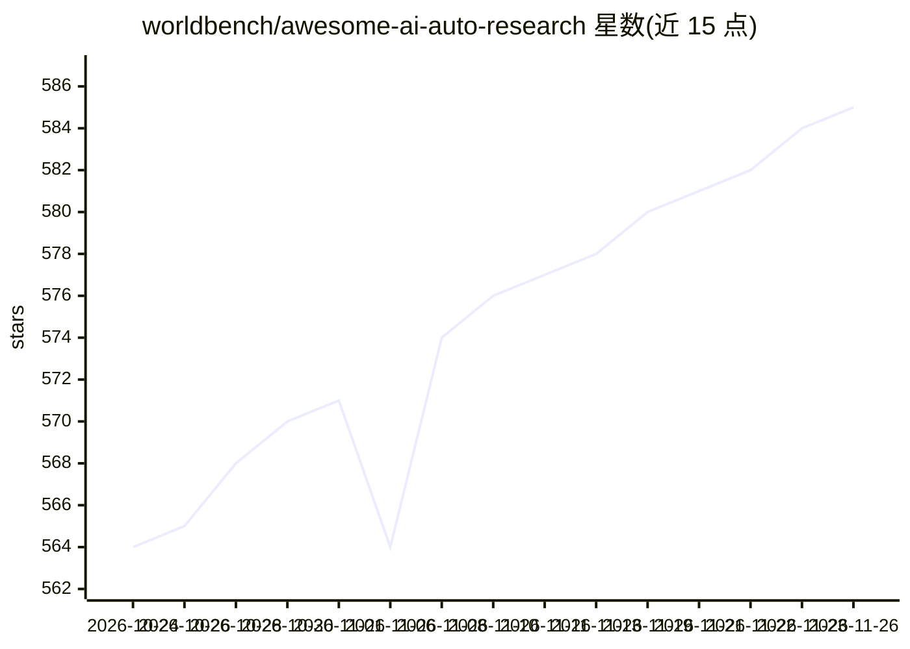

# worldbench/awesome-ai-auto-research

⭐ 585 · HTML · MIT · 推送 2026-11-20 · [GitHub](https://github.com/worldbench/awesome-ai-auto-research) · [官网](https://worldbench.github.io/awesome-ai-auto-research) · 组织维护

**科研人员：跟踪 AI 自动化科研全流程的论文清单**

随综述论文《AI for Auto-Research: Roadmap & User Guide》发布的论文策展仓库，按科研生命周期组织为四个阶段、八个环节：创意生成、文献综述、编码实验、图表制作、论文写作、同行评审、修改答辩与成果传播。每节以表格收录论文条目，含论文题名、发表会议/期刊、项目页与 GitHub 链接，按时间排序。仓库本身不提供代码安装方式，定位为论文清单与领域追踪工具。

## 筛选速览

| 维度 | 判定 | 备注 |
|---|---|---|
| AI 角色 | `ai-knowledge` | 知识聚合/清单类 |
| 许可风险 | `permissive` | MIT |
| 部署形态 | `None` |  |
| 模型依赖 | — | README 未给出锁定关系 |
| 硬件要求 | — | 无带数字的原话,不猜 |
| 安装摩擦 | `low` | 无编译、无系统依赖或容器化 |
| 成熟度 | — | 结构信号不足 |

## 能力要点

- 按科研生命周期四阶段八环节组织论文条目
- 每条目含论文、发表venue、项目页与GitHub链接
- 随附综述论文与引用信息（BibTeX）

## 适用场景

- 查找科研创意生成相关论文与代码实现
- 调研文献检索与综述生成的研究进展
- 了解 AI 辅助同行评审的研究脉络

## 场景标签

`科研工具` `精选清单` · 领域:学习与行业

## 证据(README 行号)

> L12: This repository accompanies the survey paper **"AI for Auto-Research: Roadmap & User Guide"** and tracks papers on 
> L16: We organize the academic research lifecycle as eight interconnected stages grouped into four epistemological phases

## 星数曲线

2026-10-24 564 → 2026-11-26 585（+21）

---
*卡片 v1 · prompt 1.4 · 生成 2026-11-25 · 置信度 high · 依据 README sha `470f22f955d7` · [字段定义](../../DATASET.md)*
