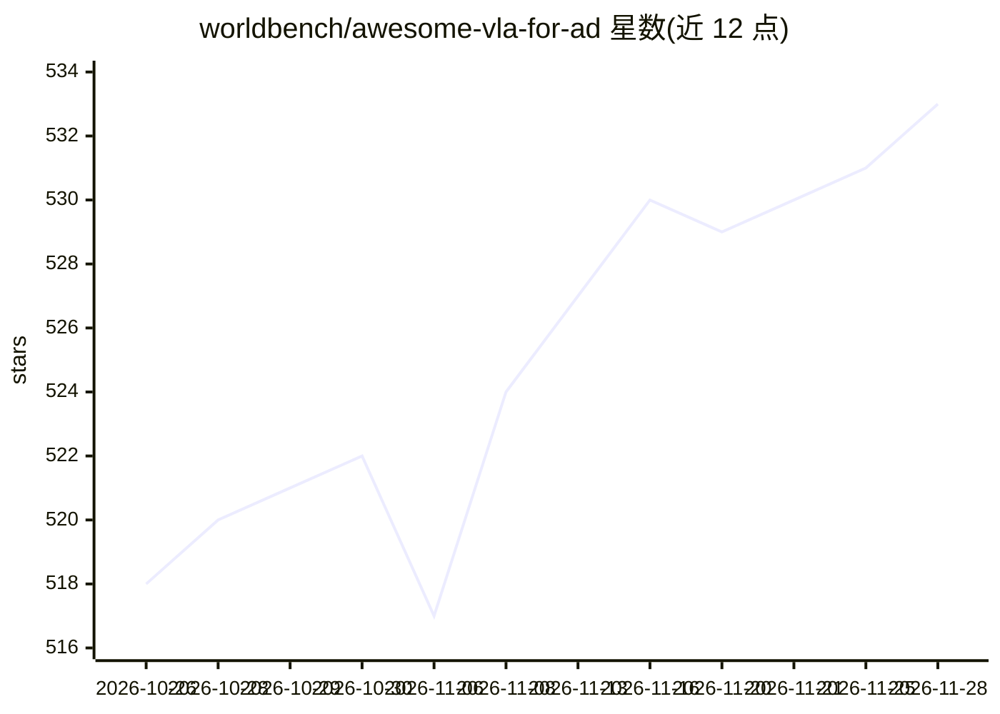

# worldbench/awesome-vla-for-ad

⭐ 533 · HTML · MIT · 推送 2026-11-14 · [GitHub](https://github.com/worldbench/awesome-vla-for-ad) · [官网](https://worldbench.github.io/vla4ad) · 组织维护

**自动驾驶 VLA/VA 模型综述论文配套的文献清单**

面向自动驾驶领域的综述型清单，梳理 Vision-Action 与 Vision-Language-Action 模型的演进，将方法组织为端到端 VLA 与双系统 VLA 两大范式，并按 Action-Only、Perception-Action、图像世界模型等类别按时间顺序列出各模型及对应论文、会议、网站与 GitHub 链接。配套提供 arXiv 论文、项目页与 HuggingFace 排行榜。面向自动驾驶研究人员，供文献调研与论文引用。

## 筛选速览

| 维度 | 判定 | 备注 |
|---|---|---|
| AI 角色 | `ai-knowledge` | 知识聚合/清单类 |
| 许可风险 | `permissive` | MIT |
| 部署形态 | `None` |  |
| 模型依赖 | — | README 未给出锁定关系 |
| 硬件要求 | — | 无带数字的原话,不猜 |
| 安装摩擦 | `low` | 无编译、无系统依赖或容器化 |
| 成熟度 | — | 结构信号不足 |

## 能力要点

- 综述配套 awesome 清单，按两大 VLA 范式组织
- 按时间顺序收录 Action-Only / Perception-Action / 世界模型等类别条目
- 提供论文、项目页与 HuggingFace 排行榜入口

## 适用场景

- 调研自动驾驶端到端与 VLA 模型的相关文献
- 查找某个自动驾驶模型的论文与代码链接
- 引用该综述作为研究背景材料

## 场景标签

`精选清单` `科研工具` · 领域:学习与行业

## 证据(README 行号)

> L6: # :sunglasses: Awesome VLA for Autonomous Driving
> L10: This survey reviews **vision-action (VA)** models and **vision-language-action (VLA)** models for autonomous drivin
> L47: |Model|Paper|Venue|Website|GitHub|

## 星数曲线

2026-10-26 518 → 2026-11-28 533（+15）

---
*卡片 v1 · prompt 1.4 · 生成 2026-11-25 · 置信度 high · 依据 README sha `353be4c43243` · [字段定义](../../DATASET.md)*
