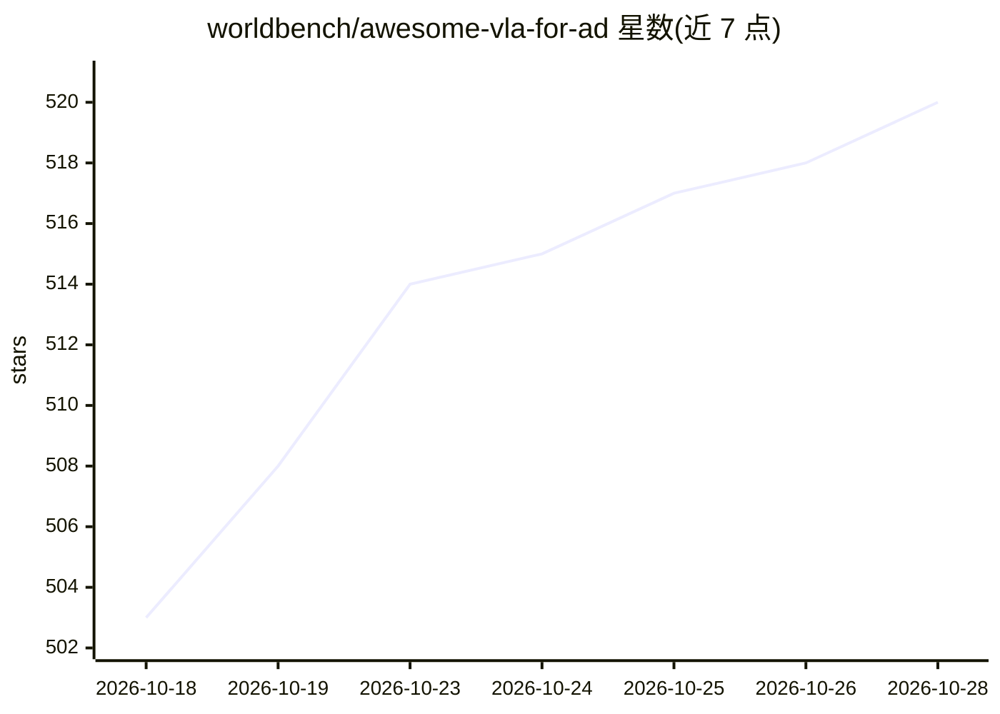

# worldbench/awesome-vla-for-ad

⭐ 520 · HTML · MIT · 推送 2026-10-27 · [GitHub](https://github.com/worldbench/awesome-vla-for-ad) · [官网](https://worldbench.github.io/vla4ad) · 组织维护

**自动驾驶 VLA 模型综述论文配套方法清单**

配套 arXiv 综述论文《Vision-Language-Action Models for Autonomous Driving: Past, Present, and Future》的 awesome 清单：收录 VA 与 VLA 模型，按 Action-Only、Perception-Action、Image-Based World Models 等类别分表组织，条目含模型名、论文、发表 venue、网站与 GitHub 链接，按时间排序。综述将方法分为端到端 VLA 与双系统 VLA 两种范式，并另附 3D/4D 世界模型综述引用、项目主页与 HuggingFace Leaderboard。面向自动驾驶与具身智能研究者。

## 筛选速览

| 维度 | 判定 | 备注 |
|---|---|---|
| AI 角色 | `ai-knowledge` | 知识聚合/清单类 |
| 许可风险 | `permissive` | MIT |
| 部署形态 | `None` |  |
| 模型依赖 | — | README 未给出锁定关系 |
| 硬件要求 | — | 无带数字的原话,不猜 |
| 安装摩擦 | `low` | 无编译、无系统依赖或容器化 |
| 成熟度 | — | 结构信号不足 |

## 能力要点

- 按 Action-Only / Perception-Action / 世界模型等类别分表收录模型条目
- 条目含模型名、论文、venue、Website 与 GitHub 链接，按时间排序
- 综述提出 End-to-End VLA 与 Dual-System VLA 两种范式划分
- 配套 arXiv 论文、项目主页与 HuggingFace Leaderboard

## 适用场景

- 查找端到端/VLA 自动驾驶方法的论文与开源代码
- 跟踪世界模型与闭环驾驶方向的最新进展
- 按时间线了解 VA 到 VLA 模型的演化

## 场景标签

`精选清单` · 领域:学习与行业

## 证据(README 行号)

> L10: This survey reviews **vision-action (VA)** models and **vision-language-action (VLA)** models for autonomous drivin
> L26:     journal = {arXiv preprint arXiv:2512.16760},

## 星数曲线

2026-10-18 503 → 2026-10-28 520（+17）

---
*卡片 v1 · prompt 1.4 · 生成 2026-10-22 · 置信度 high · 依据 README sha `3764251c174e` · [字段定义](../../DATASET.md)*
