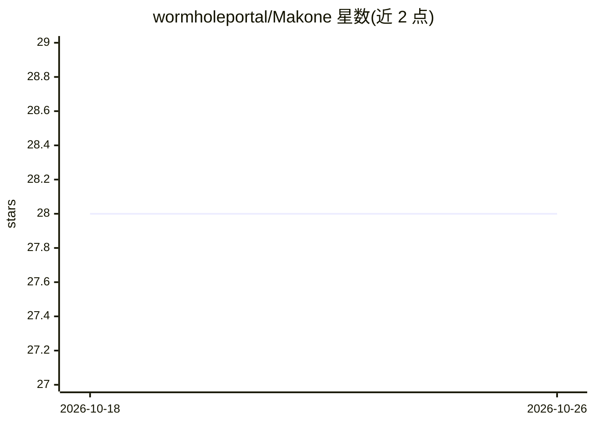

# wormholeportal/Makone

⭐ 28 · HTML · MIT · 推送 2026-09-05 · [GitHub](https://github.com/wormholeportal/Makone) · [官网](https://makone.dev) · 组织维护

**让编程 agent 用代码构建 three.js 3D 世界的工具包与技能库**

开源套件，供用户已有的编程 agent（Claude Code、Codex、Cursor 等）通过编写程序化 three.js 代码构建场景、游戏与物件。核心机制是补上 agent 的"眼睛"：capture 截图、verify 输出运动/三角形/预算等测量事实，agent 依据 brief（world.json 中声明的目标描述）迭代修正。包含 skills/ 目录（world/craft/game/object/three 五类按需加载的工艺知识页）、npm 脚本工作流（create/capture/verify/export/smoke）与本地画廊（localhost:5180）。不导入模型文件或纹理，全部几何为程序化源码，可导出为单文件 .html。创建世界需一次性安装 Playwright Chromium，纯浏览可省略。

## 筛选速览

| 维度 | 判定 | 备注 |
|---|---|---|
| AI 角色 | `ai-ecosystem` | LLM/agent 周边工具 |
| 许可风险 | `permissive` | MIT |
| 部署形态 | `library` | 以包/库形式分发 |
| 模型依赖 | — | README 未给出锁定关系 |
| 硬件要求 | — | 无带数字的原话,不猜 |
| 安装摩擦 | `low` | 无编译、无系统依赖或容器化 |
| 成熟度 | — | 结构信号不足 |

## 能力要点

- capture 截图 + verify 事实测量的闭环，agent 看图后对照 brief 修正
- skills/ 知识页按需被 agent 加载，覆盖流程、工艺、游戏与 three.js 参考
- 三类世界契约（scene/game/object），gallery 含 18 个参考实现
- 导出为无依赖单文件 .html，双击即可运行

## 适用场景

- 用编程 agent 以自然语言 brief 生成程序化 3D 场景或小游戏
- 让 agent 在写 3D 代码时能截图自检并修正渲染结果
- 学习或复用 three.js 程序化生成与 agent 技能页写法

## 场景标签

 · 领域:创意编码/3D 图形

## 证据(README 行号)

> L26: Makone closes that loop. No server, no API key, nothing to configure — **the agent is the
> L29: The agent reads skills and writes worlds built on the runtime; the harness renders them and returns frames and fact
> L85: **3 · Make something.** Open the repo in your agent CLI — Claude Code, Codex, Cursor,

## 星数曲线

2026-10-18 28 → 2026-10-26 28（+0）

---
*卡片 v1 · prompt 1.4 · 生成 2026-10-26 · 置信度 high · 依据 README sha `1ddb8f7175b2` · [字段定义](../../DATASET.md)*
