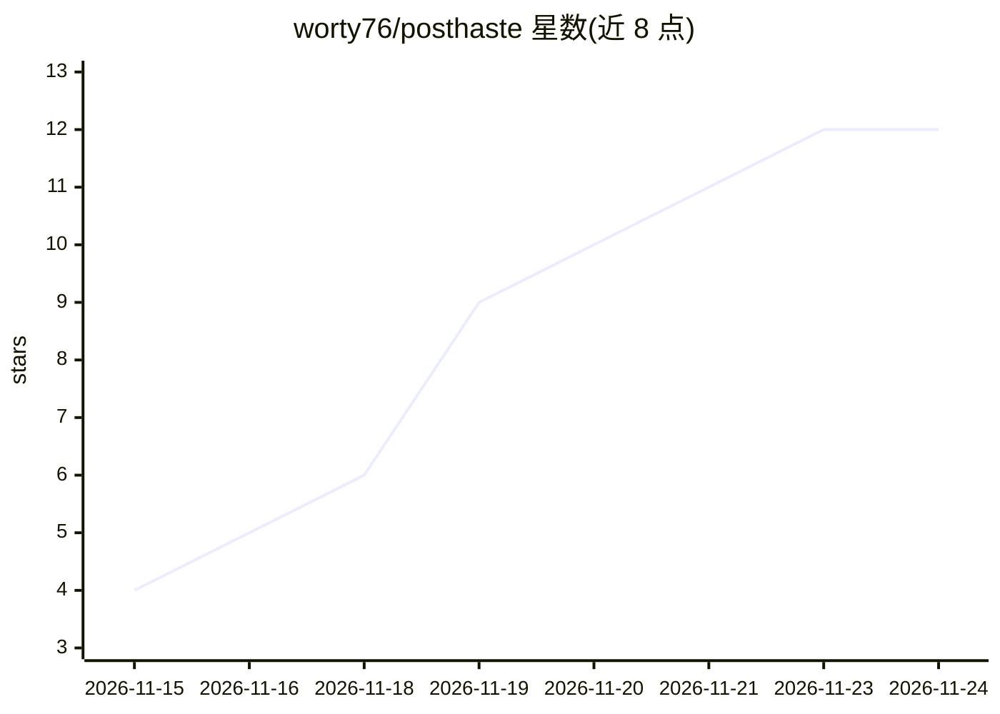

# worty76/posthaste

⭐ 12 · Rust · MIT · 推送 2026-11-22 · [GitHub](https://github.com/worty76/posthaste) · [官网](https://posthaste.ink) · 个人维护

**本地优先、键盘驱动的待办笔记应用，可选 AI 润色**

用 Rust 与 Tauri 构建的本地优先笔记与待办应用，覆盖 macOS、Windows 与 Linux。笔记存于本机单个 SQLite 文件，无账号、无中心服务器、无遥测；支持全局快捷键毫秒级弹出捕获窗口、Markdown/JSON 导出导入、回收站 30 天保留、日历回溯、附件详情等。AI 润色默认关闭，开启后将笔记发送至用户自选的服务商并使用自己的密钥，密钥存于系统钥匙串。另提供实验性的端到端加密 QUIC 设备间同步。

## 筛选速览

| 维度 | 判定 | 备注 |
|---|---|---|
| AI 角色 | `ai-enhanced` | 去掉 AI 部分产品仍成立 |
| 许可风险 | `permissive` | MIT |
| 部署形态 | `library` | 以包/库形式分发 |
| 模型依赖 | local-ok | 支持本地模型 |
| 硬件要求 | — | 无带数字的原话,不猜 |
| 安装摩擦 | `medium` | 含编译或系统依赖之一 |
| 成熟度 | — | 结构信号不足 |

## 能力要点

- 全局快捷键即时捕获，窗口预创建以毫秒级弹出
- 本地优先：单 SQLite 文件存储，无账号无遥测，可导出 Markdown/JSON
- 可选 AI 润色，支持多家服务商及本地 Ollama，密钥存系统钥匙串
- 实验性 P2P 设备同步，基于加密 QUIC (iroh)

## 适用场景

- 随时用快捷键速记想法与待办
- 在无云服务的本地环境管理个人任务
- 在多台自己的电脑间加密同步笔记
- 用自有 API 密钥对笔记做 AI 润色

## 场景标签

`知识库管理` · 领域:知识与检索

## 证据(README 行号)

> L5:  A fast, local-first note &amp; to-do app built in Rust.
> L35: - **AI polish** — optional. Off by default; when you turn it on, your note goes
> L6:  Keyboard-first for macOS, Windows and Linux, with custom looks, optional

## 星数曲线

2026-11-15 4 → 2026-11-24 12（+8）

---
*卡片 v1 · prompt 1.4 · 生成 2026-11-20 · 置信度 high · 依据 README sha `d7ea2f69f62d` · [字段定义](../../DATASET.md)*
