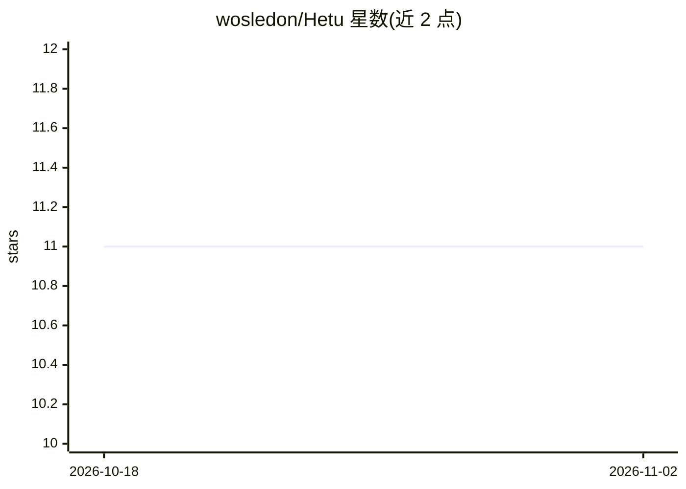

# wosledon/Hetu

⭐ 11 · C# · Apache-2.0 · 推送 2026-10-31 · [GitHub](https://github.com/wosledon/Hetu) · [官网](https://wosledon.github.io/Hetu/) · 个人维护 · 中文 README

**本地优先的 AI 知识与 Agent 工作台桌面应用**

基于 Tauri 2 + ASP.NET Core 10 + React 19 的桌面应用，将 Markdown 笔记、Agent 对话与 Code 编码会话写入同一本地数据库（SQLite/sqlite-vec 或 PostgreSQL/pgvector）。提供语义检索、知识图谱、Wiki 生成、分层记忆与 Dream 整理、看板任务与可视化工作流；Code 会话支持隔离 worktree、PTY 终端、检查点回滚与 gh/glab PR。模型调用走 OpenAI 兼容或 Anthropic 协议，支持 MCP（stdio）与技能扩展；无账户、无遥测。Windows/Linux 提供安装包，fat 版自带 .NET 10 运行时。

## 筛选速览

| 维度 | 判定 | 备注 |
|---|---|---|
| AI 角色 | `ai-native` | 本体是模型或模型工具 |
| 许可风险 | `permissive` | Apache-2.0 |
| 部署形态 | `desktop` | 安装包/桌面程序 |
| 模型依赖 | — | README 未给出锁定关系 |
| 硬件要求 | — | 无带数字的原话,不猜 |
| 安装摩擦 | `medium` | 含编译或系统依赖之一 |
| 成熟度 | — | 结构信号不足 |

## 能力要点

- 笔记/对话/代码会话共享同一数据库，检索与图谱同源
- Code 会话含隔离 worktree、PTY 终端、检查点回滚与 PR（gh/glab）
- 全局/会话/项目三层记忆与 Dream 整理（合并、衰减、遗忘）
- MCP、技能、Agent 预设与工作流接入同一 Agent 循环

## 适用场景

- 在本地统一管理笔记、AI 对话与代码修改记录
- 让 Agent 在隔离 worktree 中执行编码任务并回滚
- 用看板与工作流驱动 Agent 自动化任务
- 为项目生成 Wiki、知识图谱并长期积累记忆

## 场景标签

`知识库管理` `编码 Agent` `Agent 记忆` · 领域:Agent 开发

## 证据(README 行号)

> L19: Hetu is a desktop app with a local backend: write Markdown notes, ask an agent to work through a problem, and let C
> L73: |**Agent workspace**|Sessions and topics, SSE streaming, tool approvals, five permission modes, send queue, mid-run
> L75: |**Knowledge**|Chunking and embeddings for notes/files/URLs, index coverage, semantic search playground, knowledge 

## 星数曲线

2026-10-18 11 → 2026-11-02 11（+0）

---
*卡片 v1 · prompt 1.4 · 生成 2026-11-01 · 置信度 high · 依据 README sha `b8e56a30982f` · [字段定义](../../DATASET.md)*
