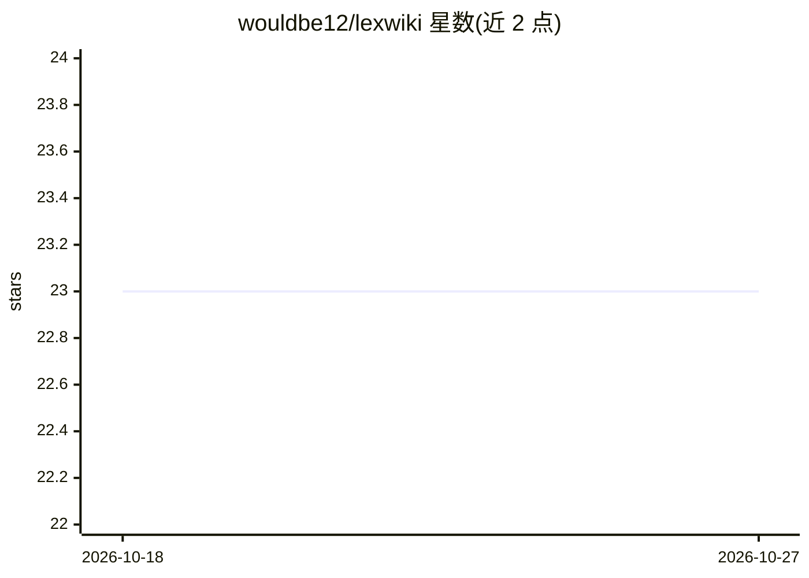

# wouldbe12/lexwiki

⭐ 23 · Python · AGPL-3.0 · 推送 2026-10-13 · [GitHub](https://github.com/wouldbe12/lexwiki) · 组织维护

**法律文档的结构化记忆库：AI 读取并持续更新，供任意 agent 查询**

面向法律工作者与法律团队的文档知识库工具：通过 MCP 接入 Claude Desktop、Claude Code、Cursor、Codex、Cline 等 agent。用户投递合同、法规、备忘录、邮件等文档后，由用户选定的开源权重 LLM（经 OpenRouter 或本地 Ollama）读取、分类、摘要并交叉引用，编译成条款库、司法辖区追踪、当事方索引、先例图等结构化库；新增文档重编译时增量更新。主 agent 只读编译后的库，不接触原始文档。提供 lint 功能查找过期引用与不一致条款。支持 PDF/Word/Excel/PPT/HTML/Markdown/纯文本输入。

## 筛选速览

| 维度 | 判定 | 备注 |
|---|---|---|
| AI 角色 | `ai-ecosystem` | LLM/agent 周边工具 |
| 许可风险 | `viral` | AGPL-3.0 |
| 部署形态 | `library` | 以包/库形式分发 |
| 模型依赖 | local-ok | 支持本地模型 |
| 硬件要求 | — | 无带数字的原话,不猜 |
| 安装摩擦 | `low` | 无编译、无系统依赖或容器化 |
| 成熟度 | — | 结构信号不足 |

## 能力要点

- 由独立 LLM 调用编译文档为条款库/索引/交叉引用的结构化 wiki
- 主 agent 只读编译库，原始文档不出 vault
- 支持 OpenRouter 或本地 Ollama 运行开源权重模型
- MCP 接入 Claude Desktop/Code、Cursor、Codex、Cline 等 agent，含 7 个工具

## 适用场景

- 把一堆客户合同整理成可查询的条款与当事方知识库
- 让 AI agent 引用库内容回答关键条款问题
- 检查库内过期法规引用与条款不一致问题

## 场景标签

`Agent 记忆` `知识库管理` · 领域:Agent 开发

## 证据(README 行号)

> L3: **Constantly-updated memory for your legal documents.** Drop in your legal knowledge: templates, actual client contr
> L30: **Your main agent (Claude, Cursor, etc.) only reads from `wiki/`.** It never sees your raw documents. The LLM that 
> L117: |What you ask|What happens|

## 星数曲线

2026-10-18 23 → 2026-10-27 23（+0）

---
*卡片 v1 · prompt 1.4 · 生成 2026-10-27 · 置信度 high · 依据 README sha `c5bd9214d629` · [字段定义](../../DATASET.md)*
