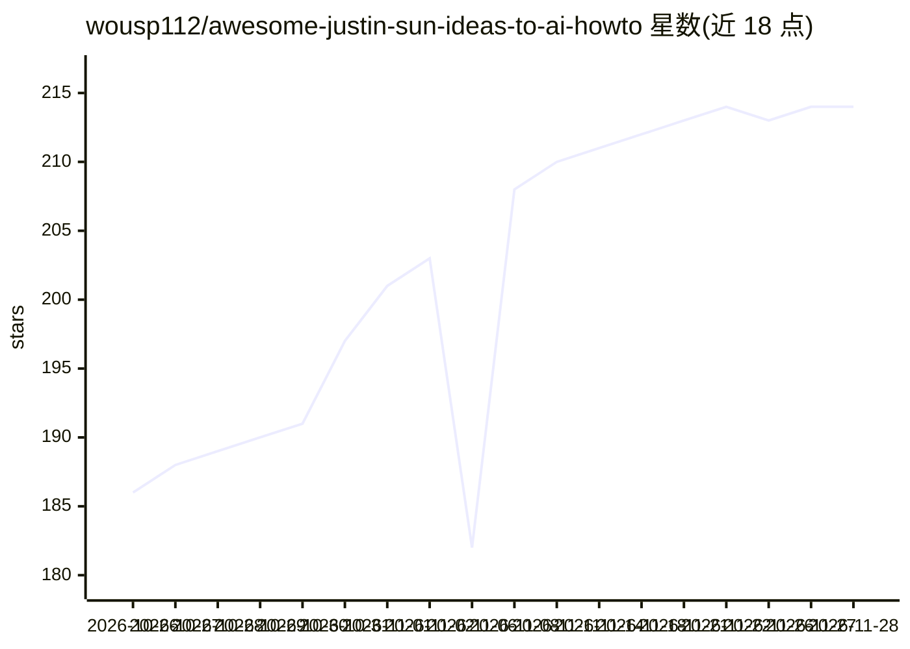

# wousp112/awesome-justin-sun-ideas-to-ai-howto

⭐ 214 · NOASSERTION · 推送 2026-11-25 · [GitHub](https://github.com/wousp112/awesome-justin-sun-ideas-to-ai-howto) · 个人维护 · 中文 README

**把孙学观点做成 25 篇可动手的 AI 实操教程**

将孙宇晨访谈（邵艾伦、金明两期，带时间戳全文）中可动手的观点整理为五章 25 节教程，每篇附原话时间点、发给 Agent 的提示词与手动步骤；工具总表标注实测价与国内可用性，覆盖跨境会员差价、免费 GPU 跑批量转录、装首个 Agent、生活记录自动日报等。可通过 npx skills 装入 Claude Code/Codex 等编程 Agent，或复制 AGENT.md 给网页版 AI。除两期访谈全文外以 CC BY 4.0 授权，访谈内容版权归原作者。

## 筛选速览

| 维度 | 判定 | 备注 |
|---|---|---|
| AI 角色 | `ai-knowledge` | 知识聚合/清单类 |
| 许可风险 | `none` | NOASSERTION |
| 部署形态 | `library` | 以包/库形式分发 |
| 模型依赖 | — | README 未给出锁定关系 |
| 硬件要求 | — | 无带数字的原话,不猜 |
| 安装摩擦 | `low` | 无编译、无系统依赖或容器化 |
| 成熟度 | — | 结构信号不足 |

## 能力要点

- 25 篇教程每篇配原话时间戳、Agent 提示词与手动步骤
- 工具总表标注实测价、核实日期与国内替代方案
- 一行 npx skills 命令装入编程 Agent，或提供 AGENT.md 给网页版 AI
- 含多模型对比示例与按真实运行记录重排的动图

## 适用场景

- 零基础装好第一个能读本地文件的 AI Agent
- 用 Google Colab 或魔搭免费 GPU 跑批量转录等任务
- 把日常记录变成每日自动复盘的 AI 日报
- 按价格和国内可用性挑选 AI 工具

## 场景标签

`教程课程` · 领域:学习与行业

## 证据(README 行号)

> L34: 孙学是孙宇晨自己的一套理论，他的说法是给大脑升级操作系统。这里把孙学里能动手的观点，做成 25 篇照着就能跑的 AI 做法。每篇带视频原话时间点、发给 Agent 的提示词和手动步骤，常用工具都在工具总表标了实测价和国内能不能直接
> L47: 已经在用 Claude Code、Codex、Gemini CLI 这类 Agent，一行命令就能把整本书的思路装进去：

## 星数曲线

2026-10-26 186 → 2026-11-28 214（+28）

---
*卡片 v1 · prompt 1.4 · 生成 2026-11-26 · 置信度 high · 依据 README sha `21bb50d6385e` · [字段定义](../../DATASET.md)*
