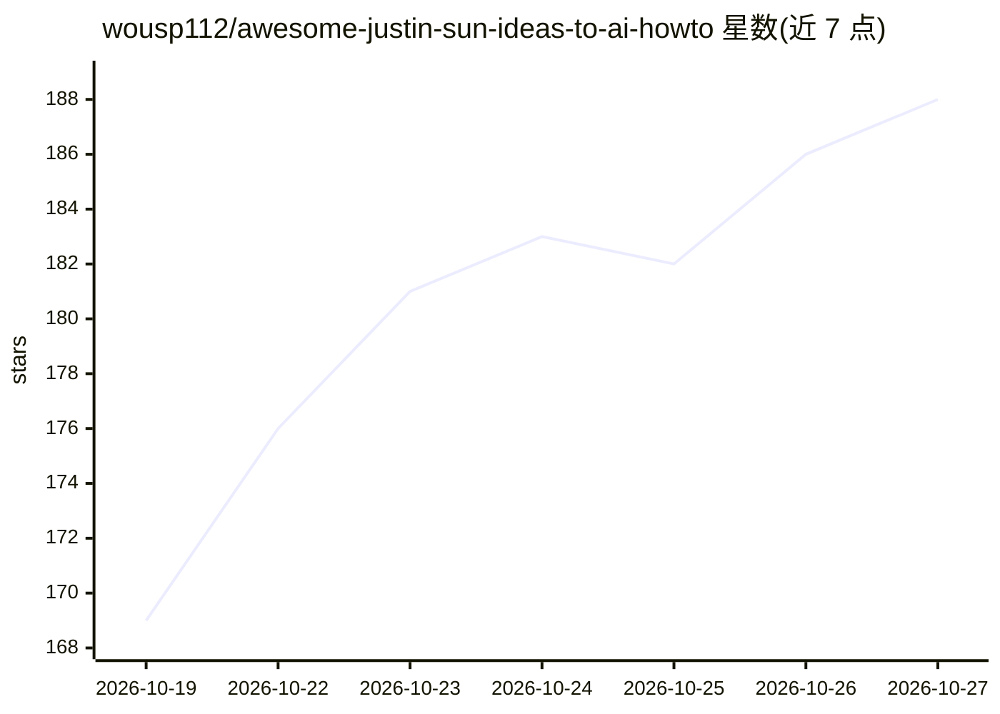

# wousp112/awesome-justin-sun-ideas-to-ai-howto

⭐ 188 · NOASSERTION · 推送 2026-10-20 · [GitHub](https://github.com/wousp112/awesome-justin-sun-ideas-to-ai-howto) · 个人维护 · 中文 README

**孙宇晨访谈带时间戳全文与配套 AI 教程的知识仓库**

整理孙宇晨两期访谈（邵艾伦 4 小时 22 分、金明 47 分钟）的带时间戳全文（约 12 万字与 1.2 万字，含勘误），并为访谈中每个观点配一篇落地教程：写明使用工具、操作步骤，以及可整段复制给 Agent 执行的指令；另维护一份记录 86 个工具在国内可用性的工具总表。核心文件 AGENT.md 可复制给任意 AI，或用一行 npx 命令装成 Claude Code / Codex 的 skill。转录用 Gemini 完成，未逐句人工听校，引用原话需回看视频。

## 筛选速览

| 维度 | 判定 | 备注 |
|---|---|---|
| AI 角色 | `ai-knowledge` | 知识聚合/清单类 |
| 许可风险 | `none` | NOASSERTION |
| 部署形态 | `library` | 以包/库形式分发 |
| 模型依赖 | — | README 未给出锁定关系 |
| 硬件要求 | — | 无带数字的原话,不猜 |
| 安装摩擦 | `low` | 无编译、无系统依赖或容器化 |
| 成熟度 | — | 结构信号不足 |

## 能力要点

- 两期访谈带时间戳全文（含 200 多处听写勘误记录）
- 23 篇教程：每篇含原话出处、步骤与写给 AI 的执行指令
- AGENT.md 可装成 Claude Code / Codex skill（npx 一行命令）
- 工具总表记录 86 个工具在国内能否直接使用

## 适用场景

- 把 AGENT.md 装进我的 Agent，让它按访谈思路给我出主意
- 带时间戳查孙宇晨访谈原话并跳转视频位置
- 照教程用国内可用的工具落地访谈里的做法

## 场景标签

`教程课程` · 领域:学习与行业

## 证据(README 行号)

> L5: 孙宇晨最近上了两期访谈。邵艾伦那期 4 小时 22 分钟，聊年轻人怎么用 AI 抓住机会。金明那期 47 分钟，聊 AI 时代钱往哪放。邵艾伦那期 YouTube 上没有字幕，没法直接丢给 AI，我们就把两期都转成了带时间戳的全文。
> L7: 访谈里不少观点能直接上手，我们给每个配了一篇教程，写清楚用什么工具、一步步怎么做。这些做法是我们按自己的理解配的，孙宇晨在访谈里没讲这么细。
> L17: |装成 skill|一行命令装进 Claude Code、Codex，见下面|

## 星数曲线

2026-10-19 169 → 2026-10-27 188（+19）

---
*卡片 v1 · prompt 1.4 · 生成 2026-10-22 · 置信度 high · 依据 README sha `2d255e6a8723` · [字段定义](../../DATASET.md)*
