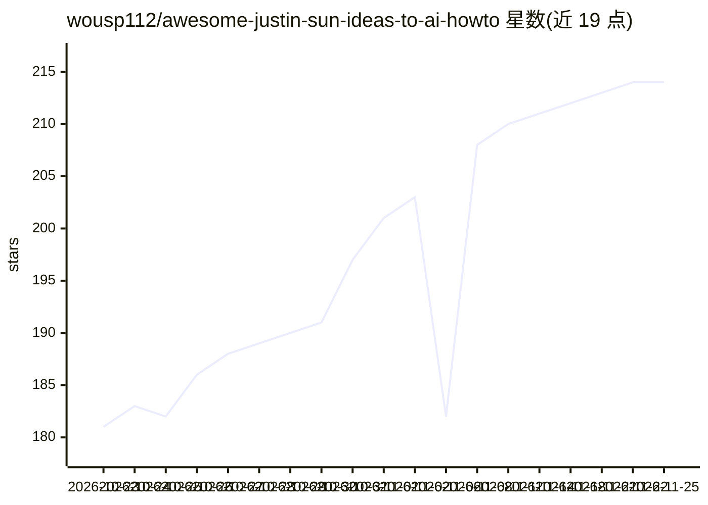

# wousp112/awesome-justin-sun-ideas-to-ai-howto

⭐ 214 · NOASSERTION · 推送 2026-10-31 · [GitHub](https://github.com/wousp112/awesome-justin-sun-ideas-to-ai-howto) · 个人维护 · 中文 README

**把孙宇晨访谈观点做成可动手的 AI 入门教程书**

该项目将孙宇晨两期访谈（邵艾伦、金明）整理为带时间戳的全文，观点可点回视频原话；对每个能动手的观点配套 AI 教程，每篇附一段可复制给 Agent 执行的提示词，同时提供逐步手动操作步骤；涉及的工具均给出国内可直接使用的版本。内容以多语言（简体中文/English）书的形式组织，持续更新并接受社区对原话、时间点、链接与价格的修正。

## 筛选速览

| 维度 | 判定 | 备注 |
|---|---|---|
| AI 角色 | `ai-knowledge` | 知识聚合/清单类 |
| 许可风险 | `none` | NOASSERTION |
| 部署形态 | `None` |  |
| 模型依赖 | — | README 未给出锁定关系 |
| 硬件要求 | — | 无带数字的原话,不猜 |
| 安装摩擦 | `low` | 无编译、无系统依赖或容器化 |
| 成熟度 | — | 结构信号不足 |

## 能力要点

- 两期访谈带时间戳全文，观点可回溯视频原话
- 每个可动手观点配一篇 AI 教程与可复制给 Agent 的提示词
- 工具均标注国内可直接使用的版本
- 采用 CC BY 4.0 授权（访谈全文除外）

## 适用场景

- 想照着教程一步步入门 AI 工具的读者
- 把教程里的提示词交给 Agent 自动完成操作
- 查阅访谈中某个观点对应的视频原话

## 场景标签

`教程课程` `提示工程` · 领域:Agent 开发

## 证据(README 行号)

> L25: 本项目旨在把孙宇晨两期访谈里能动手的观点，做成一本照着就能做的 AI 入门教程。
> L28: - 每篇教程配一段写给 AI 的话，复制给 Agent 它就照着做，也有一步步的手动做法。

## 星数曲线

2026-10-23 181 → 2026-11-25 214（+33）

---
*卡片 v1 · prompt 1.4 · 生成 2026-11-25 · 置信度 high · 依据 README sha `9170ea1e018c` · [字段定义](../../DATASET.md)*
