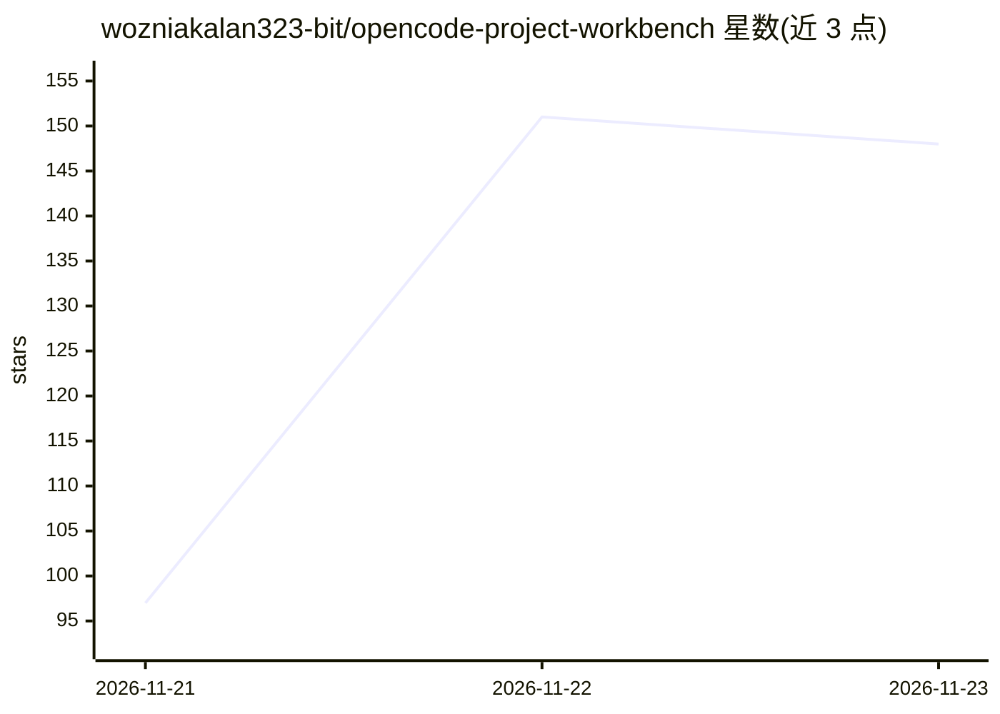

# wozniakalan323-bit/opencode-project-workbench

⭐ 148 · HTML · 推送 2026-11-22 · [GitHub](https://github.com/wozniakalan323-bit/opencode-project-workbench) · 个人维护

**为 OpenCode 项目管理工作区生命周期的 Windows 命令行工具**

面向维护多个项目的开发者的命令行工具，覆盖项目工作区的创建、配置与清理，通过单一可执行接口提供可脚本化、可重复的操作。工作方式分发现、规划、执行三阶段：读取项目清单与锁文件、生成确定性动作计划、原子化写入并区分多种退出码；支持 dry-run、幂等重跑、机器可读输出。明确不管理依赖、不配置运行时、不做沙箱，仅操作本地项目状态，核心操作无需网络。

## 筛选速览

| 维度 | 判定 | 备注 |
|---|---|---|
| AI 角色 | `ai-ecosystem` | LLM/agent 周边工具 |
| 许可风险 | `none` | — |
| 部署形态 | `None` |  |
| 模型依赖 | — | README 未给出锁定关系 |
| 硬件要求 | — | 无带数字的原话,不猜 |
| 安装摩擦 | `low` | 无编译、无系统依赖或容器化 |
| 成熟度 | — | 结构信号不足 |

## 能力要点

- 三阶段确定性工作流：发现→规划→执行，支持打印完整计划
- dry-run 与幂等初始化，写操作原子化并有独立退出码
- 项目脚手架、工作区注册表、任务追踪、模板生成等模块
- 机器可读输出模式，适配脚本与 CI

## 适用场景

- 用脚手架配置文件初始化结构一致的新项目
- 在终端内记录与跟踪项目的任务状态
- 跨多个已注册项目批量执行刷新并输出状态汇总

## 场景标签

`工作流自动化` · 领域:效率与自动化

## 证据(README 行号)

> L12: `opencode-project-workbench` is a command-line tool for managing the lifecycle of OpenCode project workspaces, cove
> L103: **Goal:** Start a new opencode-based project with a consistent structure for configuration, task tracking, and wor

## 星数曲线

2026-11-21 97 → 2026-11-23 148（+51）

---
*卡片 v1 · prompt 1.4 · 生成 2026-11-21 · 置信度 mid · 依据 README sha `de2af940b252` · [字段定义](../../DATASET.md)*
