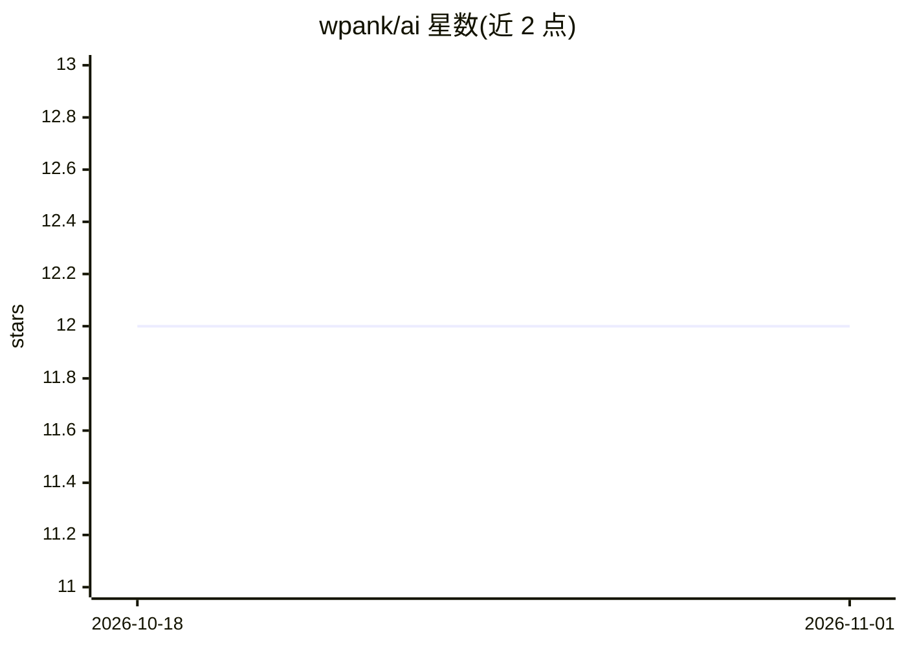

# wpank/ai

⭐ 12 · Python · 推送 2026-02-10 · [GitHub](https://github.com/wpank/ai) · 个人维护

**面向 Claude Code 与 Cursor 的技能/代理/命令策展合集（115+16+48）**

为 Claude Code 和 Cursor 两个 AI 编码助手整理的可复用资源合集：115 个以 SKILL.md 形式组织的领域技能（覆盖 API、后端、前端、设计系统、DevOps、测试、写作等 17 类）、16 个多阶段工作流代理和 48 个斜杠命令。技能可通过 skills.sh（npx add）或 clawhub 安装，代理与命令需克隆仓库后手动复制到项目的 .cursor/ 或 .claude/ 目录，支持按项目或全局安装。技能内容为模式、代码示例、反模式与决策框架等知识文档。

## 筛选速览

| 维度 | 判定 | 备注 |
|---|---|---|
| AI 角色 | `ai-knowledge` | 知识聚合/清单类 |
| 许可风险 | `none` | — |
| 部署形态 | `library` | 以包/库形式分发 |
| 模型依赖 | — | README 未给出锁定关系 |
| 硬件要求 | — | 无带数字的原话,不猜 |
| 安装摩擦 | `low` | 无编译、无系统依赖或容器化 |
| 成熟度 | — | 结构信号不足 |

## 能力要点

- 115 个技能按 17 个类别组织，每个技能是自包含的 SKILL.md
- 16 个多阶段自主工作流代理与 48 个斜杠命令
- 支持 skills.sh（npx add）与 clawhub 两种技能安装方式
- 提供 Cursor 与 Claude Code 的按项目/全局安装路径说明

## 适用场景

- 为我的 Claude Code 或 Cursor 补充特定领域的开发知识与工作流
- 查找可直接安装的前端/后端/DevOps 等编码技能
- 复用结构化代理与斜杠命令组织开发流程

## 场景标签

`精选清单` · 领域:学习与行业

## 证据(README 行号)

> L3: A curated collection of **115 skills**, **16 agents**, and **48 commands** for Claude Code and Cursor. Extend your A
> L9: |**Skills**|115|Modular knowledge modules — patterns, frameworks, and decision guides|
> L113: 115 modular AI agent skills organized across 17 categories. Each skill is a self-contained `SKILL.md` with pattern

## 星数曲线

2026-10-18 12 → 2026-11-01 12（+0）

---
*卡片 v1 · prompt 1.4 · 生成 2026-10-31 · 置信度 high · 依据 README sha `c886de0e6b0f` · [字段定义](../../DATASET.md)*
