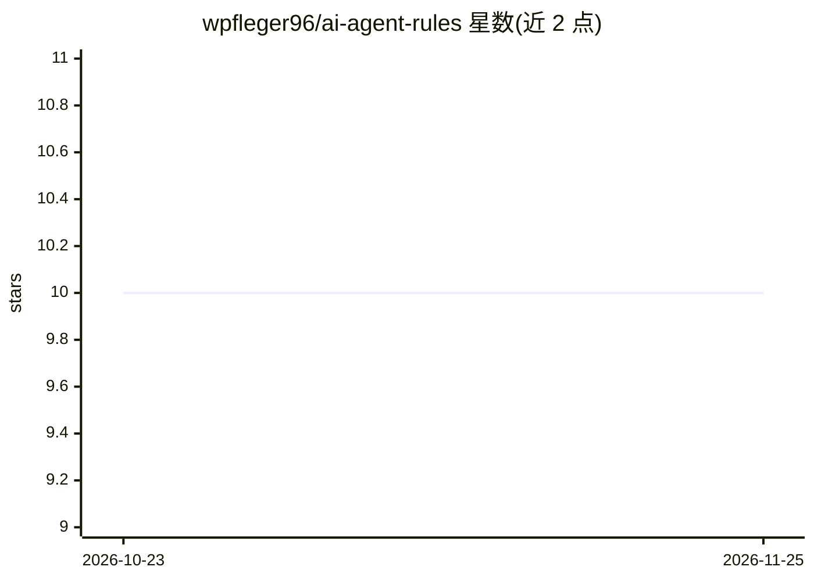

# wpfleger96/ai-agent-rules

⭐ 10 · Python · MIT · 推送 2026-11-22 · [GitHub](https://github.com/wpfleger96/ai-agent-rules) · 个人维护

**为多 AI 编码代理统一管理配置文件的 CLI 工具**

通过符号链接把 Claude Code、Codex CLI、Gemini CLI、Goose、Amp 等编码代理的配置文件收敛到单一 git 仓库：提供合并管线（base → profile → 用户 override → 保留字段缓存）、配置继承、glob 排除、跨机器同步与 MCP 服务器统一管理。以 Python CLI 形式发布，需 Python 3.10+ 与 uv，从 PyPI 安装或 GitHub/本地源码运行，含 profile 预设、shell 补全、插件声明式管理等子命令。

## 筛选速览

| 维度 | 判定 | 备注 |
|---|---|---|
| AI 角色 | `ai-ecosystem` | LLM/agent 周边工具 |
| 许可风险 | `permissive` | MIT |
| 部署形态 | `library` | 以包/库形式分发 |
| 模型依赖 | — | README 未给出锁定关系 |
| 硬件要求 | — | 无带数字的原话,不猜 |
| 安装摩擦 | `low` | 无编译、无系统依赖或容器化 |
| 成熟度 | — | 结构信号不足 |

## 能力要点

- symlink 机制将多代理配置收敛为单一 git 管理的 source of truth
- 四层合并管线：base settings → profile → 用户 override → 保留字段缓存
- MCP 服务器统一定义并翻译为各代理原生格式（JSON/TOML/YAML）
- 内置 4 个 profile 预设，支持继承链与按机器覆盖

## 适用场景

- 在多台机器间同步我的 Claude Code/Codex 配置
- 公司管理文件与个人配置分离，按 glob 排除特定文件
- 为工作电脑和个人电脑维护不同的配置 profile

## 场景标签

 · 领域:开发者工具/配置管理

## 证据(README 行号)

> L3: Manage AI agent configurations through symlinks. Keep all your configs in one git-tracked location.
> L15: Consolidates config files for AI coding agents (Claude Code, Goose, Gemini CLI, Codex CLI, Amp) into a single sourc
> L23: **Supported:** Claude Code, Goose, Gemini CLI, Codex CLI, Amp — plus Shared (AGENTS.md, skills)

## 星数曲线

2026-10-23 10 → 2026-11-25 10（+0）

---
*卡片 v1 · prompt 1.4 · 生成 2026-11-19 · 置信度 high · 依据 README sha `6eac6d305b25` · [字段定义](../../DATASET.md)*
