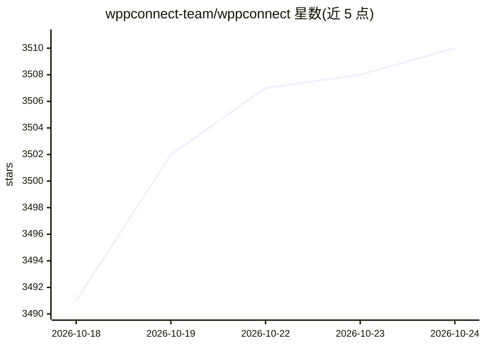

# wppconnect-team/wppconnect

⭐ 3,510 · TypeScript · NOASSERTION · 推送 2026-10-23 · [GitHub](https://github.com/wppconnect-team/wppconnect) · [官网](https://wppconnect.io) · 组织维护

**Node.js 库：导出 WhatsApp Web 功能供构建聊天机器人**

由 JavaScript 社区开发的开源项目，将 WhatsApp Web 的功能导出到 Node.js，供开发者构建客服、媒体发送、基于短语的智能识别等各类交互。功能覆盖自动刷新二维码、收发文本/图片/视频/音频/文档/贴纸、多会话管理、获取联系人与群组信息等，基于 Puppeteer 运行。通过 npm 安装，README 提示因 WhatsApp 频繁变更需保持包更新，方法名保持稳定但可能出现弃用。项目招募维护者。

## 筛选速览

| 维度 | 判定 | 备注 |
|---|---|---|
| AI 角色 | `ai-enhanced` | 去掉 AI 部分产品仍成立 |
| 许可风险 | `none` | NOASSERTION |
| 部署形态 | `library` | 以包/库形式分发 |
| 模型依赖 | — | README 未给出锁定关系 |
| 硬件要求 | — | 无带数字的原话,不猜 |
| 安装摩擦 | `low` | 无编译、无系统依赖或容器化 |
| 成熟度 | — | 结构信号不足 |

## 能力要点

- 导出 WhatsApp Web 功能到 Node.js API
- 支持收发文本/图片/视频/音频/文档/贴纸与位置消息
- 多会话管理与自动二维码刷新
- 可获取联系人、聊天、群组成员与黑名单

## 适用场景

- 构建基于 WhatsApp 的客服机器人
- 自动化收发消息与媒体文件
- 读取 WhatsApp 联系人与群组数据做自动化流程

## 场景标签

`聊天机器人` `工作流自动化` · 领域:效率与自动化

## 证据(README 行号)

> L13: > WPPConnect is an open source project developed by the JavaScript community with the aim of exporting functions fr
> L31: |Send **text, image, video, audio and docs**|✔|

## 星数曲线

2026-10-18 3,491 → 2026-10-24 3,510（+19）

---
*卡片 v1 · prompt 1.4 · 生成 2026-10-20 · 置信度 mid · 依据 README sha `05e4db57d5bc` · [字段定义](../../DATASET.md)*
