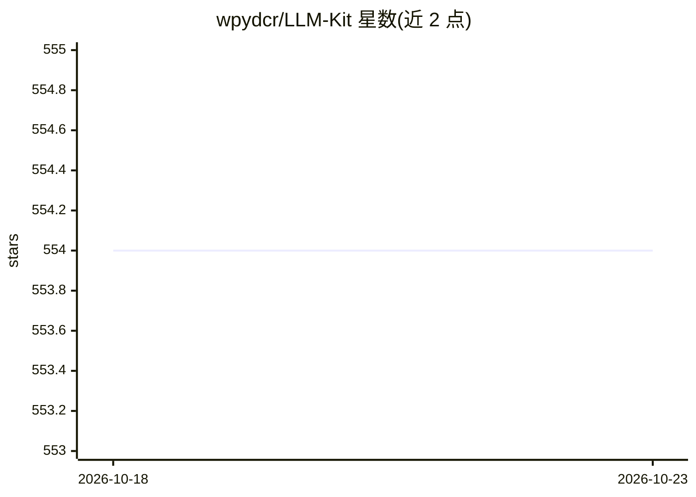

# wpydcr/LLM-Kit

⭐ 554 · Python · AGPL-3.0 · 推送 2025-11-25 · [GitHub](https://github.com/wpydcr/LLM-Kit) · 组织维护 · 中文 README

**面向不写代码用户的 LLM 全流程工具 WebUI 整合包**

名为“苏秦”的语言大模型全工具链 WebUI 整合包：通过 Web 界面接入多家 LLM API（openai/azure/文心一言/智谱/通义千问/讯飞/claude 等，无需显卡）或在本地运行与微调开源模型（chatglm2、Baichuan、Qwen 等，支持 LoRA 与全参数微调、4/8bit 量化）；另含知识库（FAISS）、MySQL 数据库接入、Agent、角色扮演、vits/svc 语音、live2d 嘴型等应用模块，以及 LLM/Embedding 数据集制作工具。在 Python 3.8-3.10、CUDA 11.7/11.8 的 Windows/Linux 环境测试，通过 git clone 加环境包与脚本运行，代码以 AGPL-3.0 开源并另提供商业授权。

## 筛选速览

| 维度 | 判定 | 备注 |
|---|---|---|
| AI 角色 | `ai-native` | 本体是模型或模型工具 |
| 许可风险 | `dual` | AGPL-3.0 |
| 部署形态 | `None` |  |
| 模型依赖 | locked-api |  |
| 硬件要求 | — | 无带数字的原话,不猜 |
| 安装摩擦 | `medium` | 含编译或系统依赖之一 |
| 成熟度 | — | 结构信号不足 |

## 能力要点

- 接入 8 家 LLM API，本地模型训练/推理支持 LoRA、全参数微调与 4/8bit 量化
- 本地知识库（FAISS）与 MySQL 数据库接入、Agent 实现
- LLM 与 Embedding 训练数据集制作及格式转换
- 角色扮演、在线/本地 TTS、vits/svc 调用、live2d 嘴型同步等应用 demo

## 适用场景

- 不写代码搭建自己的大模型对话与知识库应用
- 用 Web 界面完成开源模型的 LoRA/全参数微调与数据集制作
- 搭建带语音、表情包和 live2d 形象的角色扮演应用

## 场景标签

 · 领域:LLM 应用/训练工具

## 证据(README 行号)

> L7: ⛓️ 本项目目标是实现目前各大语言模型的全流程工具 WebUI 整合包。不用写代码即可拥有自己的定制模型与专属应用！
> L77: - [x] LLM API支持(无需显卡)
> L105: - [x] Finetune 支持

## 星数曲线

2026-10-18 554 → 2026-10-23 554（+0）

---
*卡片 v1 · prompt 1.4 · 生成 2026-10-22 · 置信度 high · 依据 README sha `715d2bde15e0` · [字段定义](../../DATASET.md)*
