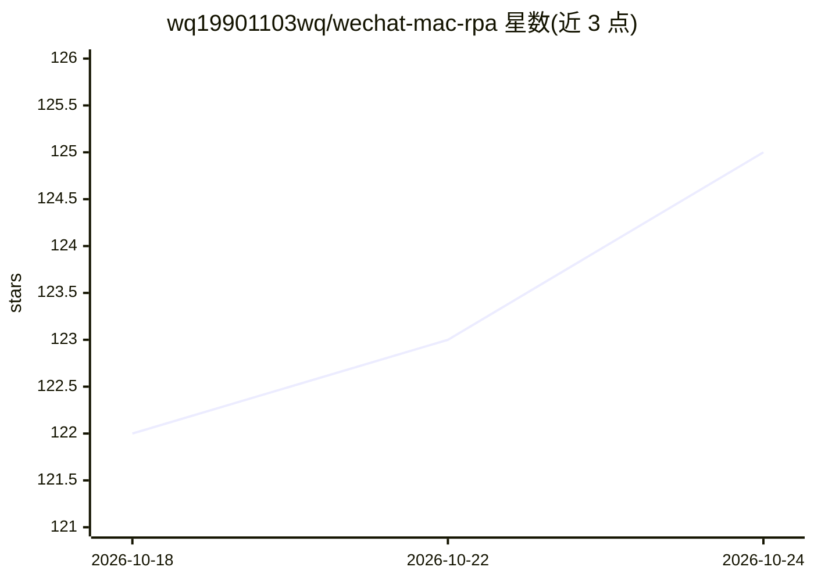

# wq19901103wq/wechat-mac-rpa

⭐ 126 · Python · MIT · 推送 2026-10-24 · [GitHub](https://github.com/wq19901103wq/wechat-mac-rpa) · [官网](https://wq19901103wq.github.io/wechat-mac-rpa/) · 个人维护 · 中文 README

**macOS 微信自动回复框架：视觉感知 + LLM Agent 读屏操作**

把微信 Mac 客户端当纯黑盒 GUI 应用，用截图 + 多模态视觉模型读取界面（SmartPipeline 带像素 Diff 缓存，本地 OCR 兜底），LLM Agent 经 ReAct 循环决定回复与工具调用，AppleScript/cliclick 执行界面操作；默认模式不碰协议、不读数据库，可选 WeFlow 模式从用户授权的本地数据库副本初始化历史记忆。记忆系统由工作/会话/长期三层组装，长期记忆含 LLM Wiki 与 BGE 向量索引；并以 LLM-as-Judge + AB Test 构建数据飞轮。需 macOS 12+、Python 3.10+，依赖屏幕录制/辅助功能权限，启动 python3 run_bot.py 运行。

## 筛选速览

| 维度 | 判定 | 备注 |
|---|---|---|
| AI 角色 | `ai-native` | 本体是模型或模型工具 |
| 许可风险 | `permissive` | MIT |
| 部署形态 | `library` | 以包/库形式分发 |
| 模型依赖 | — | README 未给出锁定关系 |
| 硬件要求 | — | 无带数字的原话,不猜 |
| 安装摩擦 | `low` | 无编译、无系统依赖或容器化 |
| 成熟度 | — | 结构信号不足 |

## 能力要点

- 感知→推理→行动→记忆→数据飞轮五层认知闭环，全链路结构化日志
- 默认 OCR/SmartPipeline 模式不碰协议、不读数据库、不注入代码
- 三层记忆（工作/会话/长期）+ BGE 向量索引 + 人工 Overrides
- LLM-as-Judge 校准 + AB Test 的自动迭代数据飞轮

## 适用场景

- 在 macOS 上让 Bot 看着微信界面自动回复消息
- 结合历史聊天记录初始化长期记忆做个性化回复
- 用管理后台查看 tick 日志、人工标注与跑 Benchmark

## 场景标签

`GUI 自动化` `聊天机器人` `Agent 记忆` · 领域:Agent 开发

## 证据(README 行号)

> L14: 让 AI 像人一样"看"着微信界面，自动回复消息。默认 OCR / SmartPipeline 模式**不碰协议、不读数据库、不注入代码**；可选 WeFlow 模式会读取用户授权的本地数据库副本，用于初始化历史记忆。
> L16: 基于**多模态视觉感知**与**LLM Agent**的 macOS 微信自动化框架。默认模式不是协议逆向或 Hook，而是把微信当作纯黑盒 GUI 应用：用计算机视觉读取界面，用大语言模型理解对话，用系统级自动化操作界面。
> L303: |**Tick**|Bot 主循环的一次迭代（当前启动入口间隔 15 秒；底层方法默认参数 5 秒），包含 感知 → 去重 → 决策 → 回复|

## 星数曲线

2026-10-18 122 → 2026-10-24 125（+3）

---
*卡片 v1 · prompt 1.4 · 生成 2026-10-23 · 置信度 high · 依据 README sha `70a1ceeeb975` · [字段定义](../../DATASET.md)*
