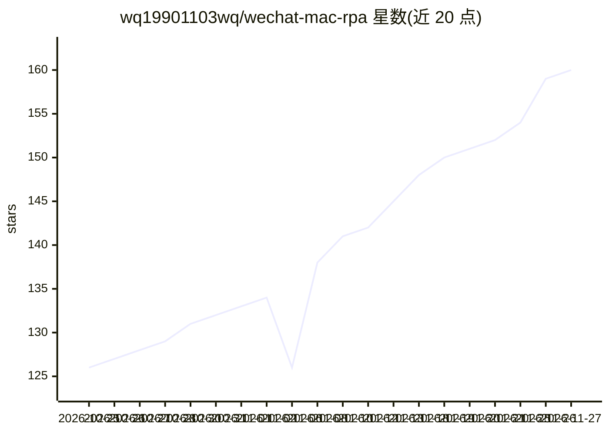

# wq19901103wq/wechat-mac-rpa

⭐ 160 · Python · MIT · 推送 2026-11-26 · [GitHub](https://github.com/wq19901103wq/wechat-mac-rpa) · [官网](https://wq19901103wq.github.io/wechat-mac-rpa/) · 个人维护 · 中文 README

**macOS 微信 GUI 自动化 Bot：视觉感知+LLM Agent 自动回复**

面向 macOS 微信客户端的自动化框架，将微信视为黑盒 GUI 应用：截图经 OCR/多模态模型提取消息，LLM Agent 经 ReAct 循环决策回复，通过 AppleScript/cliclick 操作界面发送。含像素 diff 缓存降 API 调用、LCS 跨轮消息去重、三层记忆（工作/会话/长期，LLM Wiki+BGE 语义索引）与 LLM-as-a-Judge 数据飞轮评估回路。需 macOS 12+、Python 3.10+ 及屏幕录制/辅助功能权限；WeFlow 模式可选读取本地数据库副本初始化历史记忆；仅限个人学习研究用途。

## 筛选速览

| 维度 | 判定 | 备注 |
|---|---|---|
| AI 角色 | `ai-native` | 本体是模型或模型工具 |
| 许可风险 | `permissive` | MIT |
| 部署形态 | `library` | 以包/库形式分发 |
| 模型依赖 | — | README 未给出锁定关系 |
| 硬件要求 | — | 无带数字的原话,不猜 |
| 安装摩擦 | `low` | 无编译、无系统依赖或容器化 |
| 成熟度 | — | 结构信号不足 |

## 能力要点

- 感知-推理-行动-记忆-数据飞轮五子系统认知闭环
- SmartPipeline 像素 diff 缓存：无变化时零 API 调用
- 三层记忆组装 prompt，BGE 嵌入语义检索历史对话
- LLM-as-a-Judge 校准后自动评估迭代（AB Test 验证）

## 适用场景

- 让 AI 自动回复个人微信消息并维护长期人设记忆
- 研究 GUI 自动化中感知与 Agent 推理链路的实现
- 用 LLM Judge 自动评估 bot 回复质量并迭代 prompt

## 场景标签

`聊天机器人` `GUI 自动化` · 领域:效率与自动化

## 证据(README 行号)

> L14: 让 AI 像人一样"看"着微信界面，自动回复消息。默认 OCR / SmartPipeline 模式**不碰协议、不读数据库、不注入代码**；可选 WeFlow 模式会读取用户授权的本地数据库副本，用于初始化历史记忆。
> L16: 基于**多模态视觉感知**与**LLM Agent**的 macOS 微信自动化框架。默认模式不是协议逆向或 Hook，而是把微信当作纯黑盒 GUI 应用：用计算机视觉读取界面，用大语言模型理解对话，用系统级自动化操作界面。
> L95: - **轻量化 Agent**（日常路径）：运行完整的 ReAct 循环——分析意图 → 调用工具 → 观察结果 → 重新推理。Agent 自行决定调用 `search_memory`、`web_search`、`browse_u

## 星数曲线

2026-10-25 126 → 2026-11-27 160（+34）

---
*卡片 v1 · prompt 1.4 · 生成 2026-11-27 · 置信度 high · 依据 README sha `bfa75c6f8648` · [字段定义](../../DATASET.md)*
