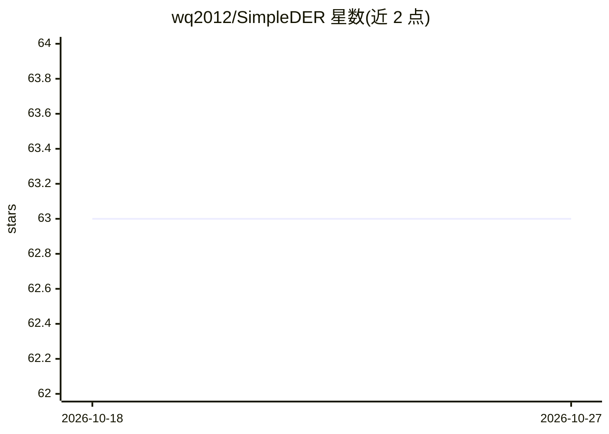

# wq2012/SimpleDER

⭐ 63 · Python · Apache-2.0 · 推送 2026-10-15 · [GitHub](https://github.com/wq2012/SimpleDER) · [官网](https://wq2012.github.io/SimpleDER) · 组织维护

**说话人日志评测指标库：计算 DER/JER/WDER 及分解**

仅依赖 numpy 与 scipy 的轻量 Python 库，用于计算说话人日志（diarization）评测指标：DER（含 Miss/False Alarm/Confusion 分解）、JER（逐说话人分解）、词级 WDER；通过 scipy 匈牙利算法求解最优说话人一一映射，支持重叠语音、collar 容差与 skip_overlap 过滤，提供语料级多录音评测、RTTM 文件读写与 CLI（python3 -m simpleder）。面向语音处理研究者与开发者，随 Google LSTM 说话人日志论文开发。

## 筛选速览

| 维度 | 判定 | 备注 |
|---|---|---|
| AI 角色 | `ai-ecosystem` | LLM/agent 周边工具 |
| 许可风险 | `permissive` | Apache-2.0 |
| 部署形态 | `library` | 以包/库形式分发 |
| 模型依赖 | — | README 未给出锁定关系 |
| 硬件要求 | — | 无带数字的原话,不猜 |
| 安装摩擦 | `low` | 无编译、无系统依赖或容器化 |
| 成熟度 | — | 结构信号不足 |

## 能力要点

- DER/JER/WDER 三种指标及各分量分解
- 匈牙利算法求最优说话人映射
- 语料级评测（corpus_der/jer/wder）与 RTTM 读写、CLI
- 仅依赖 numpy 与 scipy

## 适用场景

- 评测自己 diarization 系统输出的 DER/JER
- 在 DIHARD 类任务上按说话人权重评测（JER）
- 用 CLI 直接对 RTTM 文件打分

## 场景标签

`模型评测` · 领域:评测与运维

## 证据(README 行号)

> L7: This is a lightweight library (depending only on `numpy` and `scipy`) to compute speaker diarization evaluation metr
> L9: * **Diarization Error Rate (DER)** with full component breakdown (`Miss`, `False Alarm`, `Confusion`) and optimal sp
> L64: 3. **Optimal Mapping**: We solve the linear sum assignment problem via the Hungarian algorithm (`scipy.optimize.lin

## 星数曲线

2026-10-18 63 → 2026-10-27 63（+0）

---
*卡片 v1 · prompt 1.4 · 生成 2026-10-24 · 置信度 high · 依据 README sha `b51ef9a1439d` · [字段定义](../../DATASET.md)*
