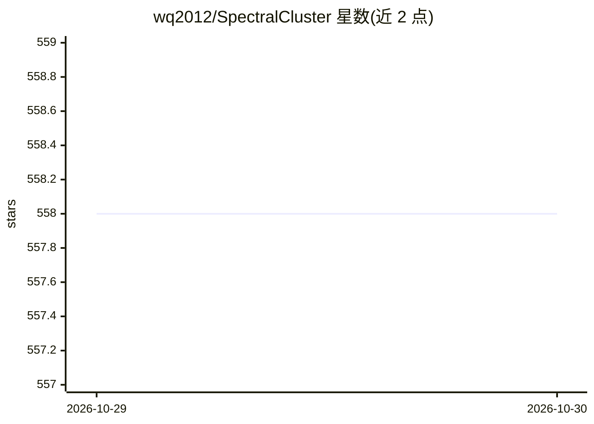

# wq2012/SpectralCluster

⭐ 558 · Python · Apache-2.0 · 推送 2026-10-28 · [GitHub](https://github.com/wq2012/SpectralCluster) · [官网](https://google.github.io/speaker-id/publications/LstmDiarization/) · 个人维护

**说话人日志论文中谱聚类算法的 Python 复现库**

以 Python 库形式复现 Google 说话人日志（speaker diarization）论文中的谱聚类算法，覆盖精化拉普拉斯矩阵、受约束谱聚类与多阶段流式聚类三类方法。输入嵌入向量 numpy 数组，通过 SpectralClusterer.predict() 输出聚类标签；支持自定义拉普拉斯类型、K-Means 距离、亲和函数、AutoTune 调参与 fallback 聚类器，MultiStageClusterer 支持逐条输入的流式聚类并修正历史标签。作者声明本库非 Google 产品、非论文原始 C++ 实现，部分功能可能缺失。

## 筛选速览

| 维度 | 判定 | 备注 |
|---|---|---|
| AI 角色 | `ai-native` | 本体是模型或模型工具 |
| 许可风险 | `permissive` | Apache-2.0 |
| 部署形态 | `library` | 以包/库形式分发 |
| 模型依赖 | — | README 未给出锁定关系 |
| 硬件要求 | — | 无带数字的原话,不猜 |
| 安装摩擦 | `low` | 无编译、无系统依赖或容器化 |
| 成熟度 | — | 结构信号不足 |

## 能力要点

- 实现精化拉普拉斯、受约束谱聚类、多阶段流式聚类三类论文算法
- 支持 4 种拉普拉斯类型、自定义距离与亲和函数
- AutoTune 自动调参 p_percentile，FallbackOptions 处理小样本与单簇判定
- MultiStageClusterer.streaming_predict 逐条输入并修正历史聚类标签

## 适用场景

- 对说话人嵌入向量做谱聚类得到说话人标签
- 复现 ICASSP 2018 等论文中的聚类流程
- 大规模嵌入时用 max_spectral_size 预聚类加速

## 场景标签

`语音识别` · 领域:感知与多模态

## 证据(README 行号)

> L11: This is a Python re-implementation of the spectral clustering algorithms
> L66: labels = configs.icassp2018_clusterer.predict(X)

## 星数曲线

2026-10-29 558 → 2026-10-30 558（+0）

---
*卡片 v1 · prompt 1.4 · 生成 2026-10-28 · 置信度 high · 依据 README sha `794c7e32688f` · [字段定义](../../DATASET.md)*
