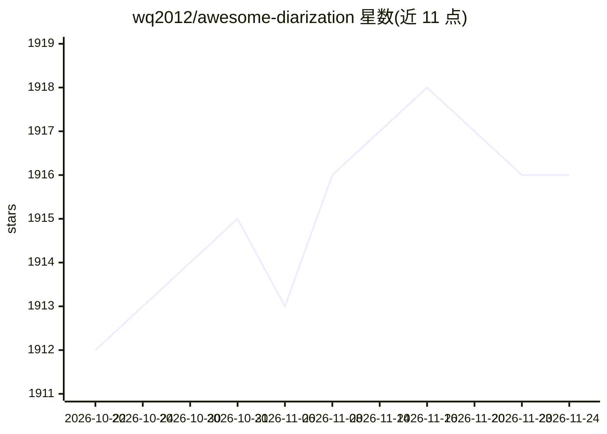

# wq2012/awesome-diarization

⭐ 1,916 · Apache-2.0 · 推送 2026-10-26 · [GitHub](https://github.com/wq2012/awesome-diarization) · [官网](https://wq2012.github.io/awesome-diarization/) · 个人维护

**说话人分离领域的论文/库/数据集策展清单**

面向说话人分离研究的资源清单，收录软件框架、评测工具、聚类与说话人嵌入方法、变检测、特征提取与数据增强等相关项目，按类别组织为表格，含语言与简要描述。社区可通过 pull request 提交新条目，仓库维护方为 Google 语音团队研究人员，条目多为第三方开源工具的链接汇编。

## 筛选速览

| 维度 | 判定 | 备注 |
|---|---|---|
| AI 角色 | `ai-knowledge` | 知识聚合/清单类 |
| 许可风险 | `permissive` | Apache-2.0 |
| 部署形态 | `None` |  |
| 模型依赖 | — | README 未给出锁定关系 |
| 硬件要求 | — | 无带数字的原话,不猜 |
| 安装摩擦 | `medium` | 含编译或系统依赖之一 |
| 成熟度 | — | 结构信号不足 |

## 能力要点

- 按框架/评测/聚类/嵌入/变检测等类别组织的软件清单
- 收录 FunASR、NVIDIA NeMo、pyannote-audio、ESPnet 等主流工具条目
- 包含论文、数据集等其他资源分类
- 社区可通过 PR 贡献条目

## 适用场景

- 调研说话人分离可用的开源工具与模型
- 为论文写作查找相关方法与数据集
- 对比不同 diarization 框架的功能范围

## 场景标签

`精选清单` · 领域:学习与行业

## 证据(README 行号)

> L7: This is a curated list of awesome Speaker Diarization papers, libraries, datasets, and other resources.
> L13: ## Software

## 星数曲线

2026-10-22 1,912 → 2026-11-24 1,916（+4）

---
*卡片 v1 · prompt 1.4 · 生成 2026-11-23 · 置信度 high · 依据 README sha `be09bd3fb42e` · [字段定义](../../DATASET.md)*
