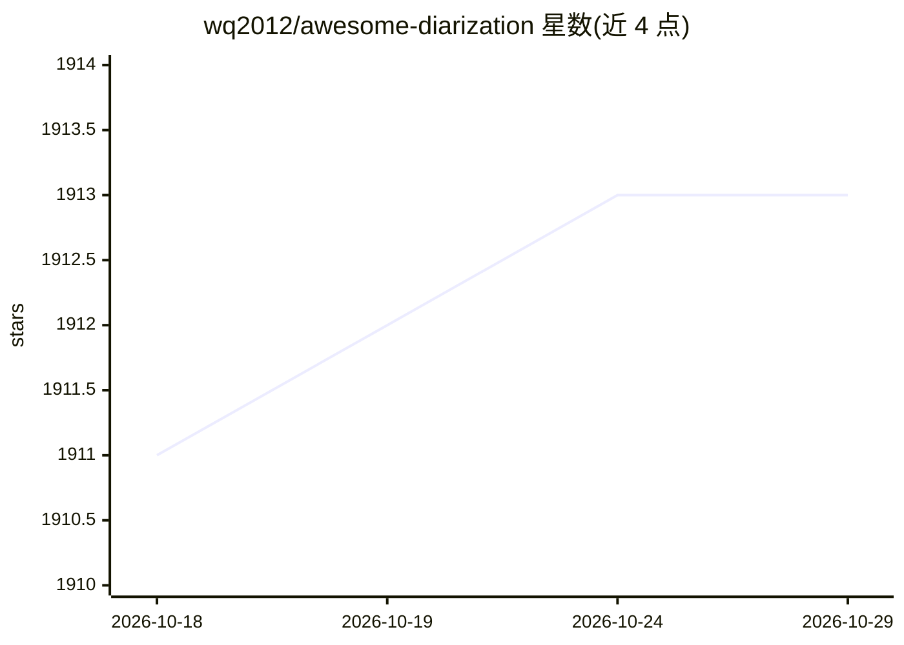

# wq2012/awesome-diarization

⭐ 1,913 · Apache-2.0 · 推送 2026-10-26 · [GitHub](https://github.com/wq2012/awesome-diarization) · [官网](https://wq2012.github.io/awesome-diarization/) · 个人维护

**说话人分离（diarization）论文、软件、数据集策展清单**

awesome 系列策展仓库，收录说话人分离（speaker diarization）领域的综述与专题论文（含 LLM 后处理、联合 ASR、在线分离、音视频分离、DIHARD 等评测）、框架与工具软件（pyannote-audio、SpeechBrain、FunASR、sherpa-onnx 等）、评测工具（pyannote-metrics、DER 计算）及聚类算法条目，按类别与年份组织，通过 PR 贡献新条目。本体为资源清单，不提供可安装运行的软件。

## 筛选速览

| 维度 | 判定 | 备注 |
|---|---|---|
| AI 角色 | `ai-knowledge` | 知识聚合/清单类 |
| 许可风险 | `permissive` | Apache-2.0 |
| 部署形态 | `None` |  |
| 模型依赖 | — | README 未给出锁定关系 |
| 硬件要求 | — | 无带数字的原话,不猜 |
| 安装摩擦 | `medium` | 含编译或系统依赖之一 |
| 成熟度 | — | 结构信号不足 |

## 能力要点

- 论文按专题分类：LLM 后处理、联合 ASR、在线分离、音视频分离、评测挑战赛
- 收录框架、评测工具、聚类算法三类软件条目并标注实现语言
- 条目通过 pull request 社区贡献

## 适用场景

- 查找说话人分离方向的研究论文与技术脉络
- 为项目挑选 diarization 框架或 DER 评测工具
- 了解相关数据集与评测挑战赛资源

## 场景标签

`精选清单` `语音识别` · 领域:学习与行业

## 证据(README 行号)

> L7: This is a curated list of awesome Speaker Diarization papers, libraries, datasets, and other resources.
> L151: ## Software

## 星数曲线

2026-10-18 1,911 → 2026-10-29 1,913（+2）

---
*卡片 v1 · prompt 1.4 · 生成 2026-10-21 · 置信度 high · 依据 README sha `430ffa11cbb3` · [字段定义](../../DATASET.md)*
