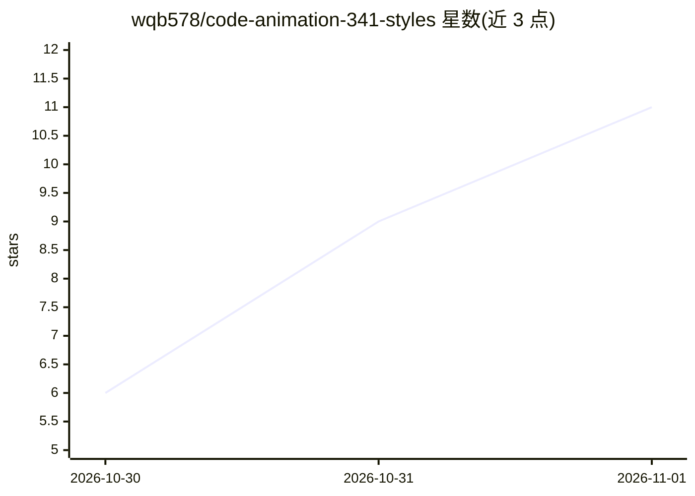

# wqb578/code-animation-341-styles

⭐ 11 · HTML · NOASSERTION · 推送 2026-10-29 · [GitHub](https://github.com/wqb578/code-animation-341-styles) · 个人维护 · 中文 README

**341 种代码动画风格提示词集合，配本地挑选网页**

由博主「俯仰观照」整理的代码动画风格提示词库：341 种风格各一个 .md 提示词，其中 193 种带同名 .jpg 静帧，按 A–G 代码样片、M 动态风格、K 卡通、Z 中国风、O 奥斯卡 98 部等十个系列组织。提示词用于复制给 Opus 5.5 或 DeepSeek 生成代码动画，部分含 {{ }} 占位符需自填主题/时长。附离线 HTML 挑选网页（Chrome/Edge 双击打开，可筛选、搜索、导出清单）与两组模型实测示例。采用自定义非商业许可，禁止包装成收费课程或付费 skills。

## 筛选速览

| 维度 | 判定 | 备注 |
|---|---|---|
| AI 角色 | `ai-knowledge` | 知识聚合/清单类 |
| 许可风险 | `none` | NOASSERTION |
| 部署形态 | `None` |  |
| 模型依赖 | — | README 未给出锁定关系 |
| 硬件要求 | — | 无带数字的原话,不猜 |
| 安装摩擦 | `low` | 无编译、无系统依赖或容器化 |
| 成熟度 | — | 结构信号不足 |

## 能力要点

- 341 种风格提示词，193 种带静帧，十系列前缀编号组织
- 离线风格挑选网页，支持筛选/搜索/勾选导出清单
- 提供 Opus 5.5 与 DeepSeek 的同题实测对比示例
- 机器可读的 _统计.json 数量统计

## 适用场景

- 做代码动画时挑选风格并复制提示词给模型
- 对比不同模型对同一风格提示词的生成效果
- 浏览 98 部奥斯卡影片等风格画风的提示词写法

## 场景标签

`提示工程` · 领域:Agent 开发

## 证据(README 行号)

> L10: 一共 **341 种**风格，每种一个提示词，Opus 5.5 能用，DeepSeek 也能用。其中 **193 种带静帧**（同名 `.jpg`）。
> L46: - **`## 风格提示词`**：**这一段就是复制给模型的内容**
> L52: **用 DeepSeek Harness（或 Claude Code）：**

## 星数曲线

2026-10-30 6 → 2026-11-01 11（+5）

---
*卡片 v1 · prompt 1.4 · 生成 2026-11-01 · 置信度 high · 依据 README sha `f45826390c23` · [字段定义](../../DATASET.md)*
