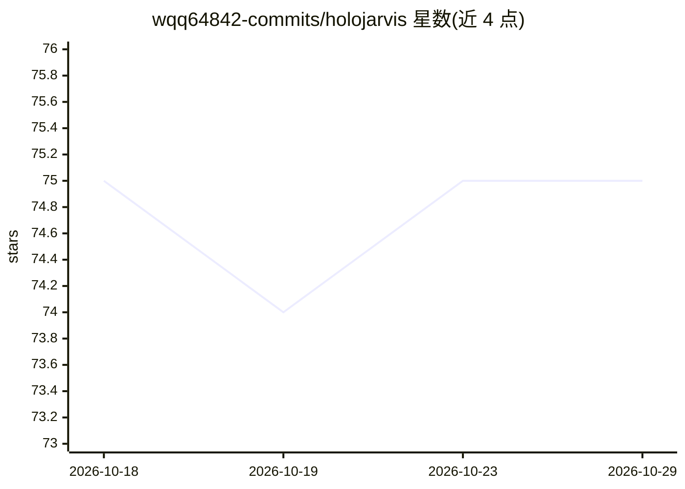

# wqq64842-commits/holojarvis

⭐ 75 · Python · MIT · 推送 2026-08-08 · [GitHub](https://github.com/wqq64842-commits/holojarvis) · 个人维护 · 中文 README

**跨平台中文语音助手：本地识别唤醒、任意大模型、工具调用与桌宠**

运行在 macOS 与 Windows 上的中文语音助手，灵感来自钢铁侠 AI 管家：用 faster-whisper 本地转写，拼音模糊唤醒词「贾维斯」，大脑通过 OpenAI 兼容接口接入用户自己的中转站（DeepSeek/GPT/Claude 等），支持 17 个内置工具与 MCP 扩展，可选 GPT-SoVITS 克隆音发声，附带 tkinter 全息 HUD 桌宠与 Three.js 3D 粒子控制台（MediaPipe 手势识别）。个人项目，面向喜欢折腾桌面语音助手的用户，从源码运行，需 Python 3.12。

## 筛选速览

| 维度 | 判定 | 备注 |
|---|---|---|
| AI 角色 | `ai-native` | 本体是模型或模型工具 |
| 许可风险 | `permissive` | MIT |
| 部署形态 | `desktop` | 安装包/桌面程序 |
| 模型依赖 | — | README 未给出锁定关系 |
| 硬件要求 | — | 无带数字的原话,不猜 |
| 安装摩擦 | `low` | 无编译、无系统依赖或容器化 |
| 成熟度 | — | 结构信号不足 |

## 能力要点

- faster-whisper 本地语音识别与拼音模糊唤醒
- OpenAI 兼容接口接入任意模型，改一行配置换模型
- 17 个内置工具 + MCP 扩展（开应用、读屏、发微信等）
- GPT-SoVITS 克隆音可选，回退系统 TTS；跨重启长期记忆

## 适用场景

- 喊「贾维斯」用语音让电脑开应用、查天气、发微信
- 用自己的中转站 API Key 接入 DeepSeek/GPT 做桌面助手
- 配合 GPT-SoVITS 让助手用克隆嗓音说话

## 场景标签

`语音 Agent` `语音合成` · 领域:对话与助手

## 证据(README 行号)

> L19: HoloJarvis 是一个跑在 **macOS / Windows** 上的**中文语音助手**，灵感来自电影里钢铁侠的 AI 管家。
> L33: - 🎙️ **本地语音识别** —— 用 faster-whisper 在本地转写，不上传你的声音。
> L35: - 🧠 **任意大模型** —— 通过你的中转站（OpenAI 兼容）接入 DeepSeek / GPT / Claude 等，改一行配置即可换模型。

## 星数曲线

2026-10-18 75 → 2026-10-29 75（+0）

---
*卡片 v1 · prompt 1.4 · 生成 2026-10-24 · 置信度 mid · 依据 README sha `e4619c0e7fcc` · [字段定义](../../DATASET.md)*
