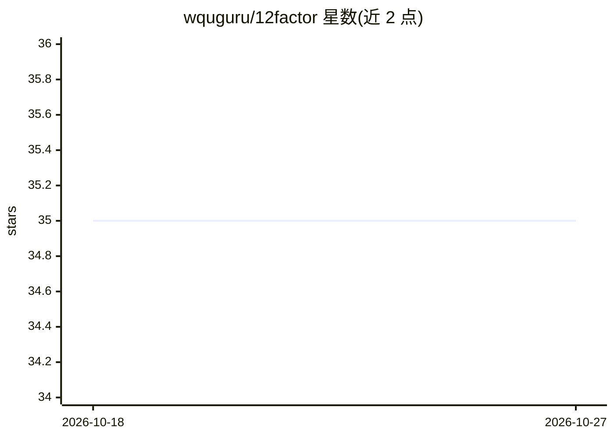

# wquguru/12factor

⭐ 35 · Jupyter Notebook · 推送 2026-08-25 · [GitHub](https://github.com/wquguru/12factor) · [官网](https://www.12factor.me/) · 个人维护 · 中文 README

**AI 协作方法论教学网站：四阶段十二原则与提示工程练习**

基于 Next.js 15 与 TypeScript 构建的双语互动学习网站，讲授 AI 辅助开发的方法论：四阶段十二原则通过互动闪卡、自适应测验与真实案例呈现；提示工程模块提供理论、引导练习与实时 LLM 实验三种模式，覆盖系统提示、思维链、令牌效率等主题。支持 OpenAI/DeepSeek/Azure 多模型接入（可选配置 API key）、进度持久化与深色模式。运行需 Node.js 与 npm，通过 npm install/dev/build 启动。

## 筛选速览

| 维度 | 判定 | 备注 |
|---|---|---|
| AI 角色 | `ai-knowledge` | 知识聚合/清单类 |
| 许可风险 | `none` | — |
| 部署形态 | `library` | 以包/库形式分发 |
| 模型依赖 | — | README 未给出锁定关系 |
| 硬件要求 | — | 无带数字的原话,不猜 |
| 安装摩擦 | `low` | 无编译、无系统依赖或容器化 |
| 成熟度 | — | 结构信号不足 |

## 能力要点

- 四阶段十二原则的互动闪卡与自适应测验
- 提示工程三模式：理论、引导练习、实时 LLM 实验
- 中英双语与进度持久化
- 多 LLM 支持（OpenAI、DeepSeek、Azure），API 带限流保护

## 适用场景

- 系统学习 AI 协作开发的方法论与原则
- 通过练习和实验掌握提示工程技巧
- 以双语教材形式在团队内推广 AI 协作规范

## 场景标签

`提示工程` `教程课程` · 领域:Agent 开发

## 证据(README 行号)

> L18: Interactive methodology framework for the Four-Stage Twelve-Principle approach to AI collaboration era. Features ha
> L38: **Four Stages:** Prepare → Execute → Collaborate → Iterate
> L44: **Three Practice Modes:**

## 星数曲线

2026-10-18 35 → 2026-10-27 35（+0）

---
*卡片 v1 · prompt 1.4 · 生成 2026-10-25 · 置信度 high · 依据 README sha `9e5529a622c8` · [字段定义](../../DATASET.md)*
