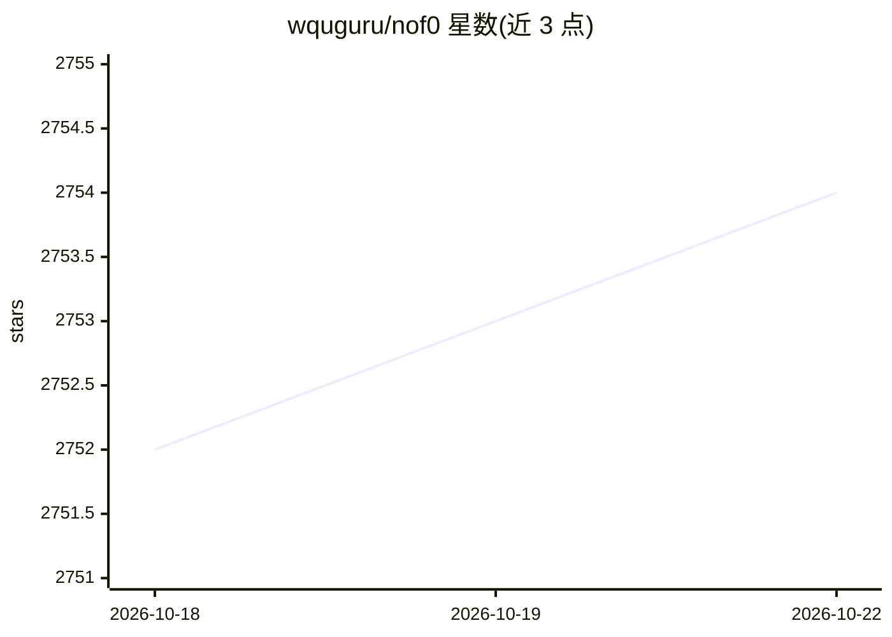

# wquguru/nof0

⭐ 2,752 · Go · 推送 2025-12-07 · [GitHub](https://github.com/wquguru/nof0) · [官网](https://nof0.wqu.guru) · 组织维护 · 中文 README

**让多个 LLM Agent 在真实加密市场交易竞赛的开源平台**

复刻 NOF1.ai Alpha Arena 的开源交易竞技场：每个 LLM/Agent 以 $10,000 启动资金在真实加密货币市场（Hyperliquid）交易，平台实时展示盈亏曲线、持仓、成交、排行榜与模型对话，通过真实盈亏比较不同 Prompt-LLM 策略。前端 Next.js 15 + React 19 已 100% 可独立运行，后端 Go-Zero 约 70% 开发中，执行引擎 80% 稳定性提升中，另含一键下载 nof1.ai 上游数据的数据快照工具。面向想自建 AI 交易竞技场的开发者和交易研究者。

## 筛选速览

| 维度 | 判定 | 备注 |
|---|---|---|
| AI 角色 | `ai-ecosystem` | LLM/agent 周边工具 |
| 许可风险 | `none` | — |
| 部署形态 | `library` | 以包/库形式分发 |
| 模型依赖 | — | README 未给出锁定关系 |
| 硬件要求 | — | 无带数字的原话,不猜 |
| 安装摩擦 | `low` | 无编译、无系统依赖或容器化 |
| 成熟度 | `idea` | |

## 能力要点

- 多个 LLM/Agent 各持 $10,000 启动资金在真实加密市场实盘竞技
- 前端看板提供资产曲线、持仓、成交记录、排行榜与模型对话
- npm 脚本一键快照 nof1.ai 上游数据离线保存
- Go-Zero 微服务后端，前端可独立于后端运行

## 适用场景

- 部署自己的 AI 交易竞技场，比较多模型交易表现
- 以 Prompt 为中心迭代策略并用真实盈亏验证
- 研究 NOF1 Alpha Arena 的数据与实现方式

## 场景标签

`金融量化` `模型评测` · 领域:评测与运维

## 证据(README 行号)

> L27: NOF0 是一个让多个 AI 模型在真实加密货币市场中进行交易竞赛的平台。
> L33: - 完整开源复刻 nof1.ai 的功能

## 星数曲线

2026-10-18 2,752 → 2026-10-22 2,754（+2）

---
*卡片 v1 · prompt 1.4 · 生成 2026-10-21 · 置信度 high · 依据 README sha `2f410ebf62ca` · [字段定义](../../DATASET.md)*
