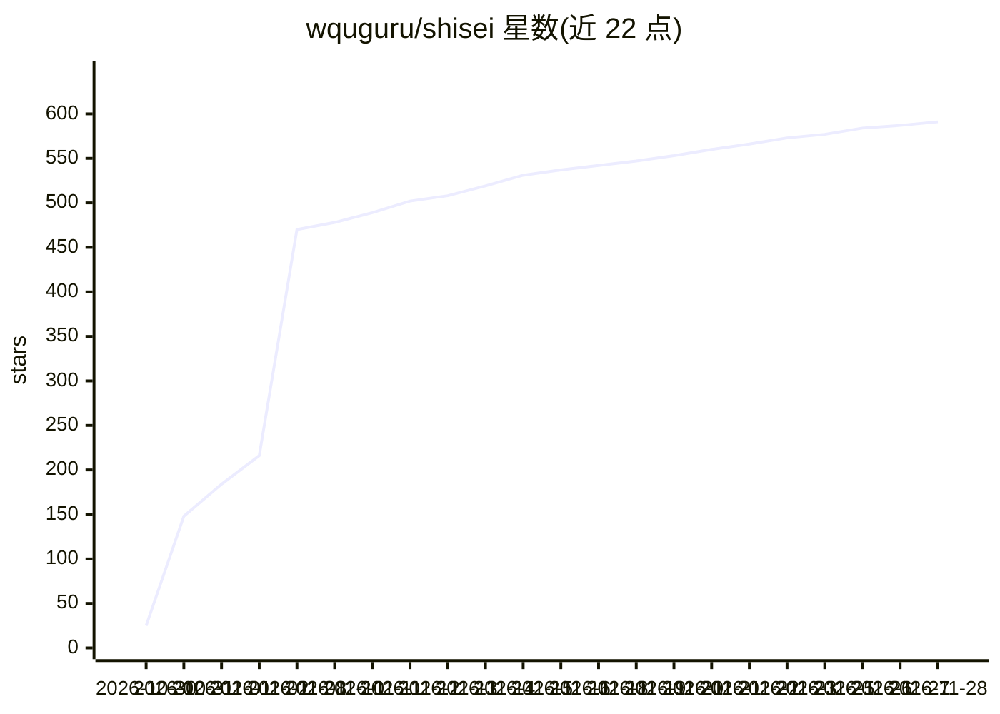

# wquguru/shisei

⭐ 591 · Python · Apache-2.0 · 推送 2026-11-14 · [GitHub](https://github.com/wquguru/shisei) · [官网](https://shisei.indaloop.app) · 个人维护 · 中文 README

**CC0 姿势参考图库：供 AI 绘图工具使用的线稿人偶素材**

自制的 CC0 人偶姿势参考库：280 个姿势分四个系列、每个 5 个相机角度，以线稿呈现，多数视角另附 clay、depth、normal 贴图（ControlNet 用）。含 89 张照片渲染。每张视图经 QC 审查，不合格视图被移除并记录原因。目录数据以 JSON/CSV 提供，日中英韩四语命名；仓库内置零依赖静态画廊，用 Python 脚本构建并本地预览。成人暗示系列默认模糊处理。

## 筛选速览

| 维度 | 判定 | 备注 |
|---|---|---|
| AI 角色 | `ai-knowledge` | 知识聚合/清单类 |
| 许可风险 | `permissive` | Apache-2.0 |
| 部署形态 | `desktop` | 安装包/桌面程序 |
| 模型依赖 | — | README 未给出锁定关系 |
| 硬件要求 | — | 无带数字的原话,不猜 |
| 安装摩擦 | `low` | 无编译、无系统依赖或容器化 |
| 成熟度 | — | 结构信号不足 |

## 能力要点

- 280 姿势 × 5 角度，共 1301 张线稿与照片，另有 944 张 clay/depth/normal 贴图
- 每张视图经 QC 审查，失败原因记录于 data/qc.json
- w300/w600/w900/full 四级尺寸，Releases 页提供分系列 zip 下载
- 四语命名目录（catalog.json/csv）与零依赖静态画廊

## 适用场景

- 给图像生成工具上传姿势参考保持角色一致性
- ControlNet 使用 depth/normal 贴图控制构图
- 绘画参考与人体姿态练习素材

## 场景标签

`图像生成` · 领域:内容生成

## 证据(README 行号)

> L5: **A free (CC0) mannequin pose reference library: 280 poses in four series × 5 camera angles, drawn as clean line art
> L27: Shisei is a self-made pose reference library. Every pose is a faceless mannequin drawn from five angles — front,
> L55: - `data/catalog.json` / `catalog.csv`: series, rating, category and name in four languages, an English pose

## 星数曲线

2026-10-30 25 → 2026-11-28 591（+566）

---
*卡片 v1 · prompt 1.4 · 生成 2026-11-25 · 置信度 high · 依据 README sha `34b05d96a176` · [字段定义](../../DATASET.md)*
