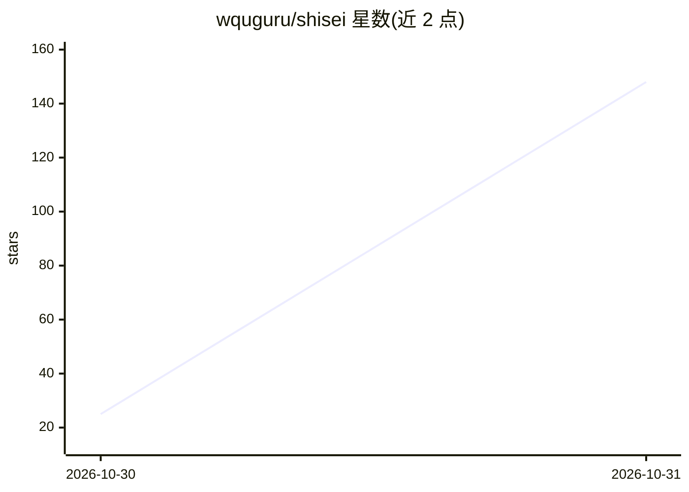

# wquguru/shisei

⭐ 148 · Python · Apache-2.0 · 推送 2026-10-30 · [GitHub](https://github.com/wquguru/shisei) · [官网](https://shisei.indaloop.app) · 个人维护 · 中文 README

**CC0 人偶姿势参考图库：280 姿势×5 角度，供 AI 绘图工具使用**

自制的姿势参考图像库：280 个姿势分四个系列，每个姿势以无脸人偶线稿从正面、四分之三、侧面、俯视、仰视五个视角绘制，可上传至图像模型作为姿势或构图参考；多角度同姿势可保持人物一致性。名称与分类提供日/中/英/韩四语。每个视角经过 QC 审核，未生成或未通过的视角留空。含 89 张 AI 生成的照片级渲染。图像与自有数据以 CC0 公有领域发布，仓库内含三层尺寸约 63 MB，全尺寸原图在 Releases 提供 zip；另带零依赖静态图库站点（web/），用 Python 脚本构建。部分系列含暗示性成人姿势，图库默认模糊显示。

## 筛选速览

| 维度 | 判定 | 备注 |
|---|---|---|
| AI 角色 | `ai-knowledge` | 知识聚合/清单类 |
| 许可风险 | `permissive` | Apache-2.0 |
| 部署形态 | `desktop` | 安装包/桌面程序 |
| 模型依赖 | — | README 未给出锁定关系 |
| 硬件要求 | — | 无带数字的原话,不猜 |
| 安装摩擦 | `low` | 无编译、无系统依赖或容器化 |
| 成熟度 | — | 结构信号不足 |

## 能力要点

- 280 姿势×5 视角的无脸人偶线稿，CC0 公有领域许可
- 四语（日/中/英/韩）姿势名称与分类目录（catalog.json/csv）
- 逐视角 QC 审核记录，失败原因存于 data/qc.json
- 零依赖静态图库站点，支持深链、过滤、四语 UI 与暗色主题

## 适用场景

- 为 Midjourney/ComfyUI 等 AI 绘图工具提供姿势与构图参考图
- 用同一姿势的多角度视图保持生成人物的视角一致性
- 人物绘画练习的免费线稿参考素材

## 场景标签

 · 领域:AI 图像生成/艺术参考素材

## 证据(README 行号)

> L5: **A free (CC0) mannequin pose reference library: 280 poses in four series × 5 camera angles, drawn as clean line art
> L26: Shisei is a self-made pose reference library. Every pose is a faceless mannequin drawn from five angles — front,
> L58: Upload a view as the pose or composition reference in your image tool. Using several angles of the same pose keeps

## 星数曲线

2026-10-30 25 → 2026-10-31 148（+123）

---
*卡片 v1 · prompt 1.4 · 生成 2026-10-30 · 置信度 high · 依据 README sha `9cb59e8e6a48` · [字段定义](../../DATASET.md)*
