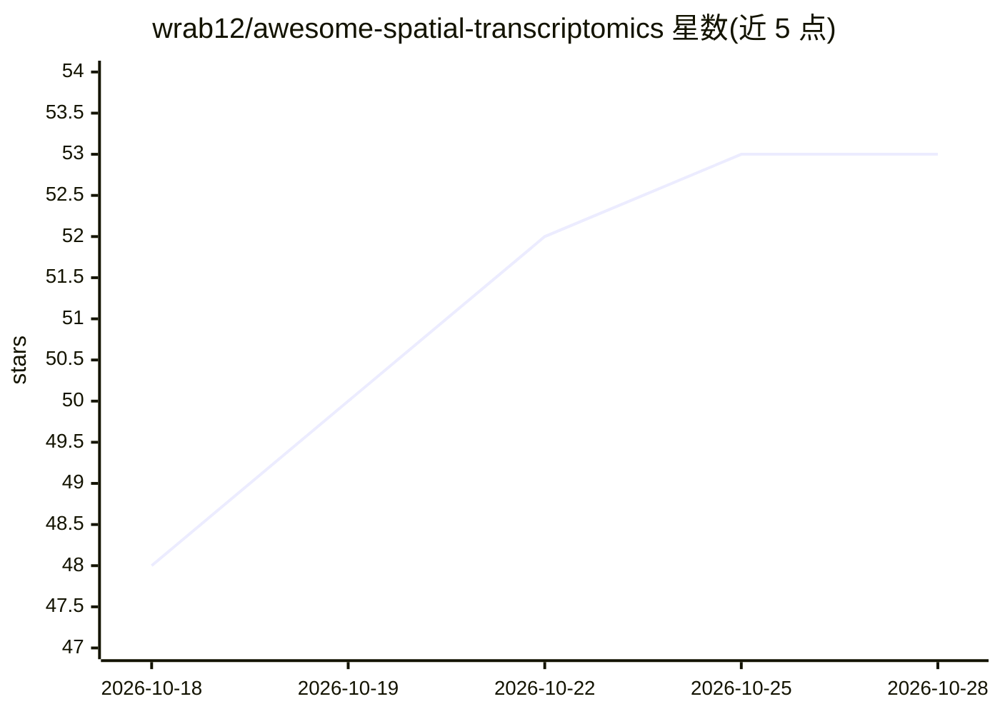

# wrab12/awesome-spatial-transcriptomics

⭐ 53 · CC0-1.0 · 推送 2026-10-19 · [GitHub](https://github.com/wrab12/awesome-spatial-transcriptomics) · 个人维护

**空间转录组学与单细胞分析的资源策展清单**

按分析流程组织的策展清单：收录空间转录组学与单细胞分析的工具、基础模型、数据集、教程与论文，章节从技术与预处理覆盖到注释、去卷积、比对、细胞通信与时空建模。条目按 GitHub 星标排序并附自动更新的星标徽章，另提供带搜索、过滤、引用计数与 BibTeX/CSV 导出功能的网站。许可为 CC0-1.0，收录内容经与来源核对。

## 筛选速览

| 维度 | 判定 | 备注 |
|---|---|---|
| AI 角色 | `ai-knowledge` | 知识聚合/清单类 |
| 许可风险 | `viral` | CC0-1.0 |
| 部署形态 | `None` |  |
| 模型依赖 | — | README 未给出锁定关系 |
| 硬件要求 | — | 无带数字的原话,不猜 |
| 安装摩擦 | `low` | 无编译、无系统依赖或容器化 |
| 成熟度 | — | 结构信号不足 |

## 能力要点

- 按实际分析流程组织章节（技术→预处理→领域→去卷积→比对→细胞通信）
- 空间转录组与单细胞方法合并收录，含 2023–2026 新工作
- 配套网站支持搜索、过滤、引用计数与 BibTeX/CSV 导出
- 每条仓库、论文链接与描述均与来源核对，星标徽章自动更新

## 适用场景

- 进入空间转录组学领域时寻找入门书籍与课程
- 为分析环节挑选工具与方法并查证基准测试
- 追踪该领域基础模型与近期综述论文

## 场景标签

`精选清单` · 领域:学习与行业

## 证据(README 行号)

> L3: > A curated list of tools, foundation models, datasets, tutorials and papers for **spatial transcriptomics** and the
> L16: - **Up to date.** Includes work from 2023–2026: tools for subcellular platforms such as Visium HD and Xenium, found

## 星数曲线

2026-10-18 48 → 2026-10-28 53（+5）

---
*卡片 v1 · prompt 1.4 · 生成 2026-10-24 · 置信度 mid · 依据 README sha `526b691aa3bc` · [字段定义](../../DATASET.md)*
