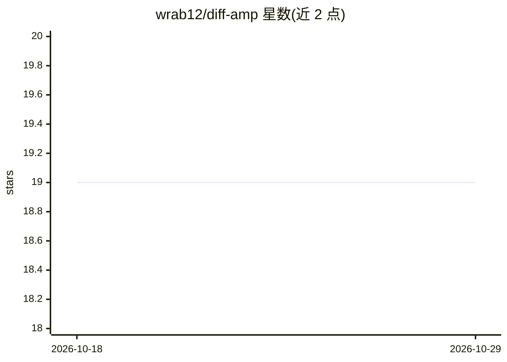

# wrab12/diff-amp

⭐ 19 · Python · 推送 2026-02-25 · [GitHub](https://github.com/wrab12/diff-amp) · [官网](https://doi.org/10.1093/bib/bbae078) · 个人维护

**抗菌肽设计一体化框架：生成、识别、性质预测与优化**

Diff-AMP 是统一抗菌肽（AMP）设计与优化框架，涵盖 AMP 生成、识别、多性质预测与强化学习迭代优化四个模块。生成模型结合扩散策略与注意力机制的 GAN 网络；识别模型基于大参数预训练模型推断潜在 AMP；CNN 模型做多性质预测；强化学习用于迭代优化。以 Python 源码仓库形式提供，需自行配置 Python 3.9 虚拟环境并安装依赖，部分数据集与权重文件需从 Google Drive 下载，另在 Hugging Face 提供三个可直接使用的模型。

## 筛选速览

| 维度 | 判定 | 备注 |
|---|---|---|
| AI 角色 | `ai-native` | 本体是模型或模型工具 |
| 许可风险 | `none` | — |
| 部署形态 | `library` | 以包/库形式分发 |
| 模型依赖 | — | README 未给出锁定关系 |
| 硬件要求 | — | 无带数字的原话,不猜 |
| 安装摩擦 | `low` | 无编译、无系统依赖或容器化 |
| 成熟度 | — | 结构信号不足 |

## 能力要点

- 扩散策略结合注意力机制的 GAN 生成模型
- 大参数预训练模型做 AMP 识别推断
- CNN 多性质预测与强化学习迭代优化
- Hugging Face 提供生成/检测/预测三个可用模型

## 适用场景

- 生成满足特定性质的抗菌肽候选序列
- 判断自有序列是否为抗菌肽
- 对生成的抗菌肽做多性质预测与迭代优化

## 场景标签

 · 领域:生物信息学/药物发现

## 证据(README 行号)

> L4: We have developed a unified AMP (Antimicrobial Peptide) design and optimization framework called Diff-AMP, which int
> L36: - You can directly use our generation model through Hugging Face: Diff-AMP Antimicrobial Peptide Generation

## 星数曲线

2026-10-18 19 → 2026-10-29 19（+0）

---
*卡片 v1 · prompt 1.4 · 生成 2026-10-28 · 置信度 mid · 依据 README sha `12df9f89aa0e` · [字段定义](../../DATASET.md)*
