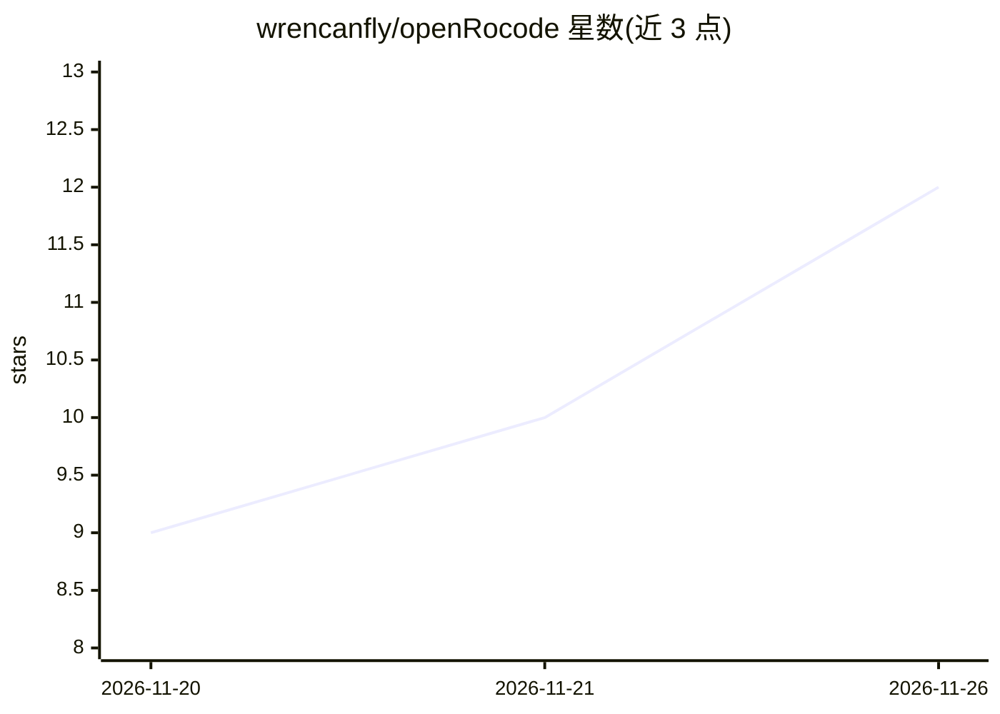

# wrencanfly/openRocode

⭐ 12 · Python · Apache-2.0 · 推送 2026-11-19 · [GitHub](https://github.com/wrencanfly/openRocode) · 个人维护

**让多模态模型以像素点击和代码驱动机器人的 agent harness**

openRocode 是一个开源 agent harness，把机器人控制转化为'3D computer use'：模型在相机图像上点击抓取点、给出可见方向或写 run_code 程序，harness 负责深度、标定、逆运动学等几何计算，并做力防护、工作区检查与紧急停止。支持浮夹爪、Franka Panda、ALOHA 双臂与 LEAP 手，可运行 robosuite 与 Meta-World 任务；每次运行为版本化 trace，带 dashboard 与 rocode bench 模型对比。约 5,300 行 Python，pip 安装，无专用 GPU，macOS/Linux，状态为 alpha。

## 筛选速览

| 维度 | 判定 | 备注 |
|---|---|---|
| AI 角色 | `ai-ecosystem` | LLM/agent 周边工具 |
| 许可风险 | `permissive` | Apache-2.0 |
| 部署形态 | `library` | 以包/库形式分发 |
| 模型依赖 | locked-api |  |
| 硬件要求 | — | 无带数字的原话,不猜 |
| 安装摩擦 | `low` | 无编译、无系统依赖或容器化 |
| 成熟度 | `idea` | |

## 能力要点

- 模型以像素点击/厘米方向操作，几何与标定不进入模型上下文
- run_code 程序与直接调用同受安全门与紧急停止约束
- 任务以 TOML 数据定义，成功条件逐条判定
- 每次运行为版本化 trace，dashboard 提供 Compare 页对比模型

## 适用场景

- 在 MuJoCo 仿真中让多模态模型执行桌面操作任务
- 对比不同模型在同一任务多个种子布局上的成功率
- 运行中随时暂停、纠偏或紧急停止模型控制
- 自定义 TOML 任务并复用 bench/trace/dashboard 全套工具链

## 场景标签

`GUI 自动化` · 领域:效率与自动化

## 证据(README 行号)

> L23: openRocode is an open agent harness that turns robot control into **3D computer use**. The model looks at camera pi
> L32: 2. **Our own small agent loop.** The core (loop, hooks, events, operator channel) is about 700 lines and talks to m
> L34: 4. **Evaluation is part of the harness, not an afterthought.** A task is data: a scene, an instruction, and a succe

## 星数曲线

2026-11-20 9 → 2026-11-26 12（+3）

---
*卡片 v1 · prompt 1.4 · 生成 2026-11-20 · 置信度 high · 依据 README sha `fabeb05351d9` · [字段定义](../../DATASET.md)*
