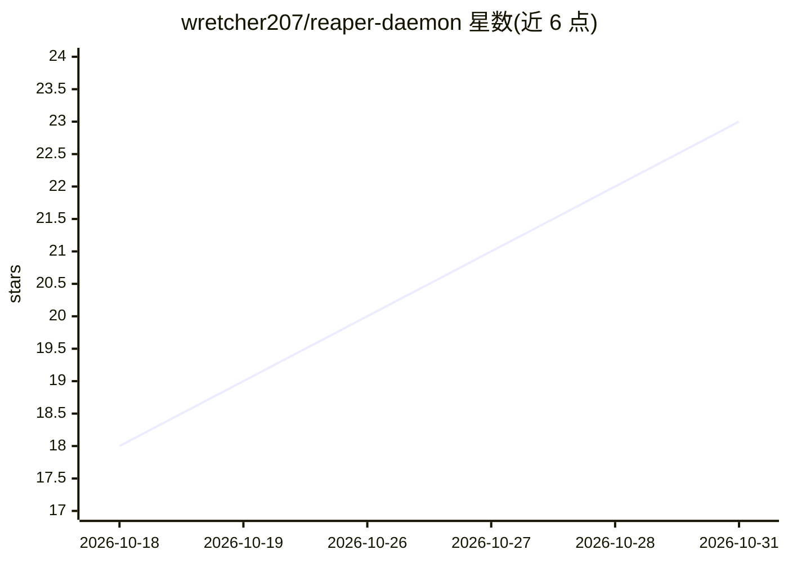

# wretcher207/reaper-daemon

⭐ 23 · Python · MIT · 推送 2026-10-21 · [GitHub](https://github.com/wretcher207/reaper-daemon) · [官网](https://www.deadpixeldesign.com/workflows/reaper-daemon/) · 个人维护

**让 AI agent 驱动 REAPER 的 MCP 服务器与文件桥**

由 Lua 桥（运行在 REAPER 内）与 Python CLI/MCP 服务器组成的工具：AI agent（Claude Code、Codex、Cursor 等）向文件夹写入 JSON 命令文件，Lua 脚本读取执行并写回结果，无网络套接字。能力覆盖轨道/FX/路由/自动化/MIDI 全读写、scan_fx 读取所有插件参数、verify_change 在混音操作前后测量响度/频谱/动态，可选音频转鼓 MIDI 转录（Demucs）。每步操作在 REAPER undo 块内，可 Ctrl+Z 回退；渲染与音频写入默认关闭，需开关授权。附带 Claude 插件（5 个技能）与 REAPER 内聊天面板。

## 筛选速览

| 维度 | 判定 | 备注 |
|---|---|---|
| AI 角色 | `ai-ecosystem` | LLM/agent 周边工具 |
| 许可风险 | `permissive` | MIT |
| 部署形态 | `None` |  |
| 模型依赖 | — | README 未给出锁定关系 |
| 硬件要求 | — | 无带数字的原话,不猜 |
| 安装摩擦 | `low` | 无编译、无系统依赖或容器化 |
| 成熟度 | — | 结构信号不足 |

## 能力要点

- JSON 文件桥协议，无网络套接字与端口，纯 Lua + Python 3
- scan_fx 读取所有插件与参数，支持写自动化与鼓 DSL
- verify_change 在混音操作前后测量响度/频谱/动态
- 所有 agent 操作包裹在 REAPER undo 块内，可撤销

## 适用场景

- 让 Claude 等 agent 对 REAPER 会话做混音并核验音频变化
- 通过 MCP 客户端或 CLI 驱动轨道、FX、MIDI 与渲染
- 在 REAPER 内用聊天面板执行音乐制作任务

## 场景标签

`GUI 自动化` · 领域:效率与自动化

## 证据(README 行号)

> L7: Reaper Daemon is a REAPER MCP server and file bridge for driving REAPER from
> L14: files, and an optional stdio MCP server, `reaper_mcp.py`, exposes the same
> L127: **MCP server.** `reaper_mcp.py` wraps the bridge as tools over stdio.

## 星数曲线

2026-10-18 18 → 2026-10-31 23（+5）

---
*卡片 v1 · prompt 1.4 · 生成 2026-10-28 · 置信度 high · 依据 README sha `5a1cf0c3a8d2` · [字段定义](../../DATASET.md)*
