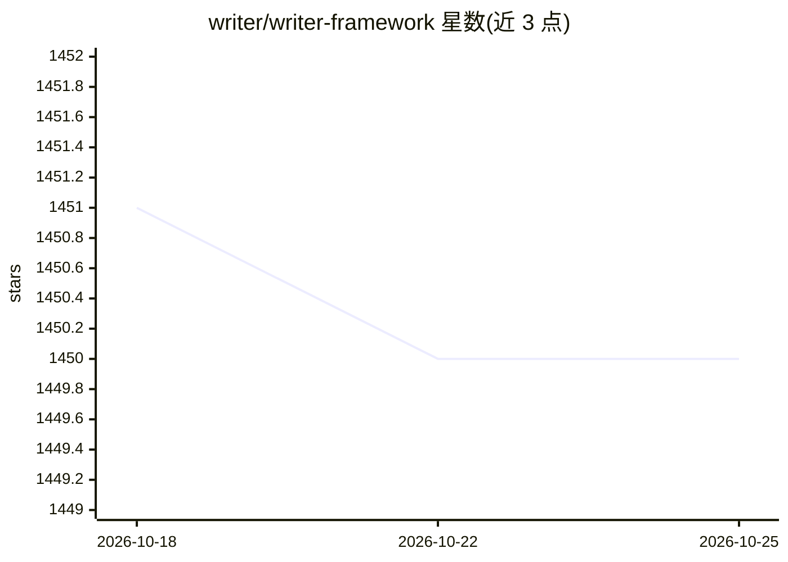

# writer/writer-framework

⭐ 1,450 · Python · Apache-2.0 · 推送 2026-10-23 · [GitHub](https://github.com/writer/writer-framework) · [官网](https://dev.writer.com/framework/introduction) · 组织维护

**可视化拖拽 UI + Python 后端的数据/AI 应用开发框架**

开源框架，用于创建 AI 应用与数据应用：前端通过浏览器中的可视化编辑器拖拽组件构建 UI，后端用 Python 编写业务逻辑，实现 UI 与逻辑分离。支持 Linux/Mac/Windows，兼容 Python 3.9.2–3.12；pip 安装后用 writer 命令创建、编辑与运行应用。由企业 Writer 维护，该公司同时运营企业级生成式 AI 平台。项目采用 Apache 2.0 许可。

## 筛选速览

| 维度 | 判定 | 备注 |
|---|---|---|
| AI 角色 | `ai-ecosystem` | LLM/agent 周边工具 |
| 许可风险 | `permissive` | Apache-2.0 |
| 部署形态 | `library` | 以包/库形式分发 |
| 模型依赖 | — | README 未给出锁定关系 |
| 硬件要求 | — | 无带数字的原话,不猜 |
| 安装摩擦 | `low` | 无编译、无系统依赖或容器化 |
| 成熟度 | — | 结构信号不足 |

## 能力要点

- 可视化编辑器拖拽构建 UI，Python 编写后端逻辑
- writer 命令行创建/编辑/运行应用，内置 demo 模板
- UI 与业务逻辑分离的语法
- 跨 Linux/Mac/Windows，支持 Python 3.9.2–3.12

## 适用场景

- 快速搭建带界面的 AI 应用或数据可视化应用
- 用拖拽方式原型化 UI，Python 处理后端逻辑
- 构建需要前后端分离、可测试的数据应用

## 场景标签

 · 领域:应用开发框架/数据应用

## 证据(README 行号)

> L3: Writer Framework is an open-source framework for creating AI applications. Build user interfaces using a visual edit
> L26: The `writer edit` command opens the visual editor in your browser where you can build your UI by dragging and dropp

## 星数曲线

2026-10-18 1,451 → 2026-10-25 1,450（-1）

---
*卡片 v1 · prompt 1.4 · 生成 2026-10-21 · 置信度 high · 依据 README sha `848b83e06bfc` · [字段定义](../../DATASET.md)*
