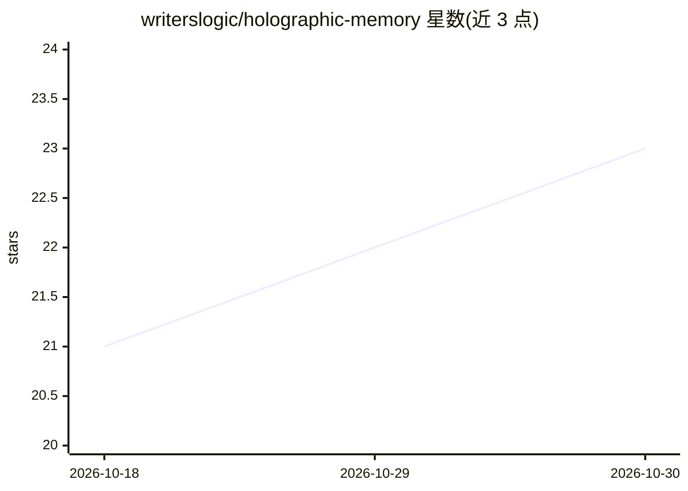

# writerslogic/holographic-memory

⭐ 23 · Rust · Apache-2.0 · 推送 2026-10-29 · [GitHub](https://github.com/writerslogic/holographic-memory) · [官网](https://holographic-memory.com) · 个人维护

**本地优先的 Rust 记忆与向量检索引擎，供 agent 与应用嵌入**

以单一可嵌入 Rust 引擎把全文检索（词干 BM25、布尔/短语查询）、图向量索引、记忆 API（remember/recall/forget/explain）与向量符号事实层（稀疏超向量 bind/bundle/permute、Hopfield 清理）存储在本机目录，无网络调用与遥测。提供 Node.js、C、WASM、UniFFI 绑定、带 Python 客户端的 HTTP 服务器及 MCP 服务器。面向需要记忆的 agent、本地优先离线应用与向量符号研究场景。README 附带与 hnswlib/tantivy/SQLite FTS5 等的对比数据及落后的条目；索引构建时间与内存占用在多项对比中不及比较对象。

## 筛选速览

| 维度 | 判定 | 备注 |
|---|---|---|
| AI 角色 | `ai-ecosystem` | LLM/agent 周边工具 |
| 许可风险 | `permissive` | Apache-2.0 |
| 部署形态 | `library` | 以包/库形式分发 |
| 模型依赖 | — | README 未给出锁定关系 |
| 硬件要求 | — | 无带数字的原话,不猜 |
| 安装摩擦 | `medium` | 含编译或系统依赖之一 |
| 成熟度 | — | 结构信号不足 |

## 能力要点

- 全文+向量混合检索与记忆 API（时间有效性、来源溯源）合一
- 向量符号层：稀疏超向量 bind/bundle/permute 与 Hopfield 清理
- 无服务调用、无遥测、无模型下载，可选 AES-256-GCM 静态加密
- 提供 Rust/Node.js/Python(WASM/UniFFI) 多语言绑定与 MCP 服务器

## 适用场景

- 为 agent 或助手添加带遗忘机制的本地记忆
- 本地优先或离线应用中嵌入全文与向量检索
- 向 MCP 客户端（编辑器、agent 宿主）暴露记忆存储
- 向量符号记忆与容量实验研究

## 场景标签

`向量数据库` `Agent 记忆` · 领域:Agent 开发

## 证据(README 行号)

> L5: **Local memory for agents and apps: full-text and vector search, a memory API and a vector-symbolic fact store in on
> L34: Holographic Memory (HMS for short) is a Rust library that stores text, vectors and facts in a
> L52: |An agent or assistant that needs memory|A memory API with forgetting that removes facts from the store, and an MCP

## 星数曲线

2026-10-18 21 → 2026-10-30 23（+2）

---
*卡片 v1 · prompt 1.4 · 生成 2026-10-28 · 置信度 high · 依据 README sha `267176d0555b` · [字段定义](../../DATASET.md)*
